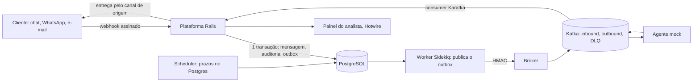

# Help Desk CloudWalk

Plataforma de help desk própria, AI first, multi-marca (InfinitePay, JIM) e multi-equipe, do projeto Inteli × CloudWalk. Projeto individual de um mês. O agente de IA real está fora do escopo: um agente mock conversa com a plataforma por webhook, broker e Kafka, como no desenho atual da CloudWalk.

O [roadmap](ROADMAP.md) mostra em que ponto o projeto está, bloco a bloco. A documentação completa (requisitos, regras, arquitetura, decisões) está no [índice](#índice).

## O problema

O help desk atual da CloudWalk é de terceiros: é lento, tem defeitos recorrentes, não permite priorizar features e não se adapta à operação com várias marcas e equipes. A pergunta que o projeto responde ([01](docs/01-visao-geral.md)):

> Como construir uma plataforma de help desk própria, AI first, multi-equipe e multi-marca, que integre agentes de IA como atendentes de ponta a ponta, distribua os casos em filas configuráveis e escale para o volume da operação com priorização e handoff humano adequados?

## O que existe hoje

| Pedido do TAP | Onde está |
| --- | --- |
| Entrada por chat, WhatsApp e e-mail (simulados) | Webhooks assinados em `/webhooks/:canal/:conta`; adaptadores no formato da Cloud API da Meta e do Gmail ([07, seção 5.0](docs/07-arquitetura.md)); simulador do cliente em `:4000` |
| Filas configuráveis | `/configuracao`: filas e regras E/OU com versão, equipes e atendentes (só supervisor) |
| Triagem, prioridade e distribuição | Triagem por palavras-chave, conjunto de regras versionado, distribuição a analistas online respeitando a capacidade, SLA com aviso e estouro |
| Agente de IA por broker e Kafka | Plataforma → outbox → broker (HMAC) → Kafka → agente mock → Kafka → plataforma, com `trace_id` ponta a ponta |
| Handoff com resumo | Pedido de humano, escalação do agente ou prazo da IA levam o caso à fila humana com o resumo do agente |
| Painel do analista | Fila de escalas, contexto, histórico do atendimento e dos anteriores, resposta, nota interna e resolução |
| Rastreabilidade e auditoria | `audit_events` só de inserção, com `trace_id`, versão das regras e modelo do agente; linha do tempo por conversa |
| Indicadores da operação | `/fila`, só supervisor: volume por fila, espera, SLA e taxa de escalação com janela e população explícitas (ADR-025) |
| Memória e contexto | Contexto do turno com as mensagens pendentes e o histórico, versionado e com prova (ADR-022) |
| Experimento técnico | [`bench/`](bench/README.md): hipótese, método, limitações e roteiro de carga (E1 e E5) |

## Arquitetura



Princípios que não mudam ([AGENTS.md](AGENTS.md), invariantes): ingestão em uma transação e `202` só depois do commit; nada externo dentro de transação (tudo passa pelo outbox); consumidor idempotente; uma ação final por turno; prazos no Postgres, nunca em `perform_in`; isolamento por marca em tudo; auditoria só de inserção; contratos validados por JSON Schema na entrada e na saída. O motivo de cada escolha está nos [ADRs](docs/08-decisoes-de-arquitetura.md).

**Stack:** Ruby on Rails 8 com Hotwire, PostgreSQL, Sidekiq e Redis, Apache Kafka 4.x (KRaft) com Karafka, broker, agente mock, canais simulados e scheduler em Ruby, OpenTelemetry, Prometheus e Grafana, Docker Compose, RSpec e k6.

## Como instalar e rodar

Pré-requisitos: Docker com Compose e `make`. A máquina de referência tem 4 vCPU e 8 GB.

```bash
cp .env.example .env   # opcional: o make up cria se faltar
make up                # sobe postgres, redis, kafka, web, worker, scheduler, consumer, broker, agente mock e canais simulados, e cria o banco
make seed              # carrega os dados sintéticos (semente em SEED)
```

Abra http://localhost:3000. A tela inicial lista as conversas de exemplo.

**Entrar no painel.** O painel pede login (ADR-024). O seed cria, em cada marca, uma supervisora (`supervisora@helpdesk.test`) e analistas (`analista1.infinitepay@helpdesk.test`, `analista1.jim@helpdesk.test`, e assim por diante), todos com a senha sintética `senha-sintetica-1`. Cada usuário vê só as marcas da equipe dele; DLQ e evals são do supervisor. Se o seu banco é anterior ao bloco 14, rode `make reset` para criar as senhas.

**Demonstração pelo chat.** O simulador do cliente fica em http://localhost:4000. O seed cria, em cada marca, um cliente **verificado** com conta no chat do app, para a IA poder consultar dados da conta (RN-05):

| Conta do provedor | `account_id` | Cliente |
| --- | --- | --- |
| `infinitepay-chat-mock` | `acc_infinitepay_000021` (já vem preenchido no simulador) | verificado |
| `jim-chat-mock` | `acc_jim_000021` | verificado |

Qualquer outro `account_id` chega como cliente não verificado, e a IA pede identificação antes de consultar. Num banco que já recebeu mensagens dessas contas antes do seed, a identidade continua com o cliente não verificado: rode `make reset`.

| Comando | Para |
| --- | --- |
| `make check` | Testes, rubocop e brakeman. Precisa passar antes de abrir o pull request |
| `make logs` | Acompanha os logs |
| `make reset` | Recria o banco e carrega o seed |
| `make down` | Para o ambiente |

**No Windows:** se o clone foi feito antes do `.gitattributes` existir, os arquivos podem ter fim de linha CRLF e o contêiner `web` cai com `: invalid option`. Corrija uma vez na pasta do projeto:

```powershell
git config core.autocrlf input
git rm -rq --cached .
git reset --hard
```

Para rodar sem Docker, com Postgres e Redis locais, veja a seção "Comandos" do [AGENTS.md](AGENTS.md). Onde fica cada coisa: [docs/10](docs/10-organizacao-do-repositorio.md).


## Roteiro da demonstração

Com `make up && make seed` feitos:

1. **Entrada pelo chat.** Em http://localhost:4000, envie "meu repasse não caiu" na conta `infinitepay-chat-mock`. A plataforma confirma (`202`) e o agente mock responde pelo mesmo canal. Veja a conversa em http://localhost:3000.
2. **Rajada.** Envie três mensagens seguidas. O turno só abre depois da janela de 1,5 s e a resposta cobre as três (RN-55 e RN-56). Rode o cenário de rajada na tela para ver uma resposta superada ser rejeitada.
3. **WhatsApp e e-mail.** Na seção "WhatsApp e e-mail" do simulador, escreva pelos dois canais. A resposta volta pelo canal de origem; no e-mail, na mesma thread.
4. **Handoff.** Clique em "Pedir humano". O caso entra na fila humana com o resumo do agente. Marque `analista1.infinitepay@helpdesk.test` como online (senha `senha-sintetica-1`): a distribuição entrega o caso a ele. Responda, anote e resolva com um motivo. Assumir o caso à mão e transferir ainda não existem.
5. **Configuração.** Entre como `supervisora@helpdesk.test`, em `/configuracao`, edite uma regra e veja a versão nova valer na próxima mensagem. A auditoria da conversa mostra a versão aplicada.
6. **Falha.** No simulador, derrube o provedor do chat com "falha simulada" e veja a entrega ser retentada com o mesmo `delivery_id` (sem duplicar) e, esgotadas as tentativas, falhar ou ir para conciliação, conforme a resposta do provedor (07, seção 3.2).
7. **Isolamento.** Entre como analista da JIM e abra uma conversa da InfinitePay: `404`.

## Modelos e configurações

| O que | Onde | Padrão |
| --- | --- | --- |
| Perfil do agente mock | `AGENT_PROFILE` ou pela tela do simulador, por marca ou global | `rapido` (também `lento` e `mudo`) |
| Semente dos dados e do agente | `SEED` e `AGENT_SEED` | `42` |
| Prazo do turno, teto do ciclo, aviso de progresso | [RN-46](docs/06-regras-de-negocio.md), [RN-57](docs/06-regras-de-negocio.md) | 20 s, 60 s, 15 s |
| Janela de agrupamento de rajada | [RN-55](docs/06-regras-de-negocio.md) | 1,5 s ou 4 s; 0 no e-mail |
| Regras de roteamento e filas | `/configuracao` (versionadas, [ADR-003](docs/08-decisoes-de-arquitetura.md), [ADR-013](docs/08-decisoes-de-arquitetura.md)) | conjunto inicial do seed |
| Contas e segredos dos canais | `provider_accounts`; segredo em `PROVIDER_SECRET_<CONTA>` | `dev-secret-<conta>` só em desenvolvimento |

O agente é **mock e determinístico** ([ADR-008](docs/08-decisoes-de-arquitetura.md)): não há modelo de linguagem. Ele responde por regras sobre o contexto do evento, o que torna os experimentos reproduzíveis.

## Metodologia experimental

O experimento principal mede carga e latência (E1) e capacidade com réplicas (E5). Hipótese, método, perfis de carga, métricas e comandos estão em [`bench/README.md`](bench/README.md): k6 em modelo aberto, semente fixa, três execuções por cenário, e uma reconciliação no banco que conta mensagens perdidas, turnos superados e a latência por etapa. Os demais experimentos (resiliência, filas, handoff, segurança) são cobertos por testes automatizados descritos no [05](docs/05-requisitos-nao-funcionais.md).

## Resultados

- **Testes automatizados:** mais de 1.600 exemplos na plataforma, além dos do broker, do agente mock, dos contratos e dos canais simulados. `make check` roda tudo com rubocop e brakeman.
- **Validação operacional (blocos 17 e 18):** 1.694 exemplos na suíte completa da plataforma, sem falhas, domínio com 99,31% de cobertura; RuboCop e Brakeman passaram. E2/E3/E4/E6 somam 166 exemplos no executor reproduzível. Há também observação com Kafka e entrega real no Compose, roteiro de configuração no navegador e capturas. Consulte [resultados e limites](docs/11-validacao-operacional.md) e [como repetir](bench/validation/README.md).
- **Carga (E1 e E5):** **ainda não medida.** O roteiro está pronto e testado, mas nenhuma execução foi feita no Compose. Os números entram em `bench/results/` e aqui quando existirem. Nenhuma meta de desempenho do [05](docs/05-requisitos-nao-funcionais.md) está comprovada.
- **Fluxo ponta a ponta com Kafka real:** comprovado nos testes por partes e, nos blocos iniciais, no Compose. A validação dos blocos recentes com `make up` e Kafka real está pendente (veja a coluna "Situação" do roadmap).

## Limitações

- O agente é mock: a qualidade das respostas e a latência de um modelo real não são avaliadas.
- Os canais são simulados no formato dos provedores. Ficam de fora: assinatura nativa da Meta e do Pub/Sub, template do WhatsApp fora da janela de 24 h, status de entrega por canal, anexos além dos metadados.
- Triagem por palavras-chave, não por modelo.
- O supervisor cadastra equipes e atendentes humanos pela configuração; cadastro de marcas e tempos da IA por marca ainda faltam. A política de senha é básica; assumir caso manualmente e transferir ainda não existem.
- Falhas de dependência foram injetadas nos testes; não há medição de queda física de Redis nem estudo de usabilidade com duas pessoas. Os limites dos blocos 17 e 18 estão no [relatório](docs/11-validacao-operacional.md).
- O ambiente Compose roda em desenvolvimento com a pasta montada, o que pesa nas medições ([bench/README.md](bench/README.md), limitação 2).
- Dados só sintéticos.

## Evolução

Propostas, que só entram por pedido explícito ([09](docs/09-evolucao-da-integracao-com-ia.md)): leitura de contexto sob demanda por MCP, base de conhecimento com `pgvector`, LLM como juiz nos evals, replay e modo sombra para avaliar versões do agente, e um perfil de produção para o experimento de carga.


## Índice

| # | Documento | Conteúdo | Status |
| --- | --- | --- | --- |
| 01 | [Visão geral](docs/01-visao-geral.md) | Problema, objetivo, pergunta norteadora | Rascunho |
| 02 | [Escopo](docs/02-escopo.md) | Dentro e fora do escopo, premissas, restrições | Rascunho |
| 03 | [Atores e glossário](docs/03-atores-e-glossario.md) | Perfis de usuário e termos do domínio | Rascunho |
| 04 | [Requisitos funcionais](docs/04-requisitos-funcionais.md) | 61 RF em 11 módulos, critérios de aceite, rastreabilidade com o TAPI | Rascunho |
| 05 | [Requisitos não funcionais](docs/05-requisitos-nao-funcionais.md) | RNF com métricas | Rascunho |
| 06 | [Regras de negócio](docs/06-regras-de-negocio.md) | 57 RN em 12 temas, parâmetros padrão e perguntas para o onboarding | Rascunho |
| 07 | [Arquitetura](docs/07-arquitetura.md) | Princípios, componentes, fluxos, modelo de dados, contratos, falhas, escalabilidade e segurança | Rascunho |
| 08 | [Decisões de arquitetura](docs/08-decisoes-de-arquitetura.md) | Stack escolhida e 18 ADRs com alternativas e consequências | Rascunho |
| 09 | [Evolução da integração com a IA](docs/09-evolucao-da-integracao-com-ia.md) | Fronteira do agente, leitura sob demanda, RAG, desempenho e avaliações | Proposta |
| 10 | [Organização do repositório](docs/10-organizacao-do-repositorio.md) | Para que serve cada pasta, onde ficam migrations, Redis, Kafka e contratos | Rascunho |
| 11 | [Validação operacional](docs/11-validacao-operacional.md) | Evidências e limites de E2/E3/E4/E6, configuração e indicadores | Executado com limites registrados |

## Como contribuir

As regras de branch, commit, pull request e TDD estão no [CONTRIBUTING.md](CONTRIBUTING.md). Agentes de IA seguem também o [AGENTS.md](AGENTS.md).

## Convenções

- **IDs:** `RF-XX`, `RNF-XX` e `RN-XX`. Um ID nunca é reaproveitado; um requisito removido fica marcado como *descontinuado*.
- **Prioridade (MoSCoW):** **M** (Must, obrigatório), **S** (Should, importante), **C** (Could, desejável), **W** (Won't, fora desta entrega).
- **Rastreabilidade:** cada RF aponta para as RN que aplica, e cada RNF para o experimento que o comprova.

## Fonte

- TAPI "Help Desk Integrado a Agentes de IA" (Inteli × CloudWalk).
