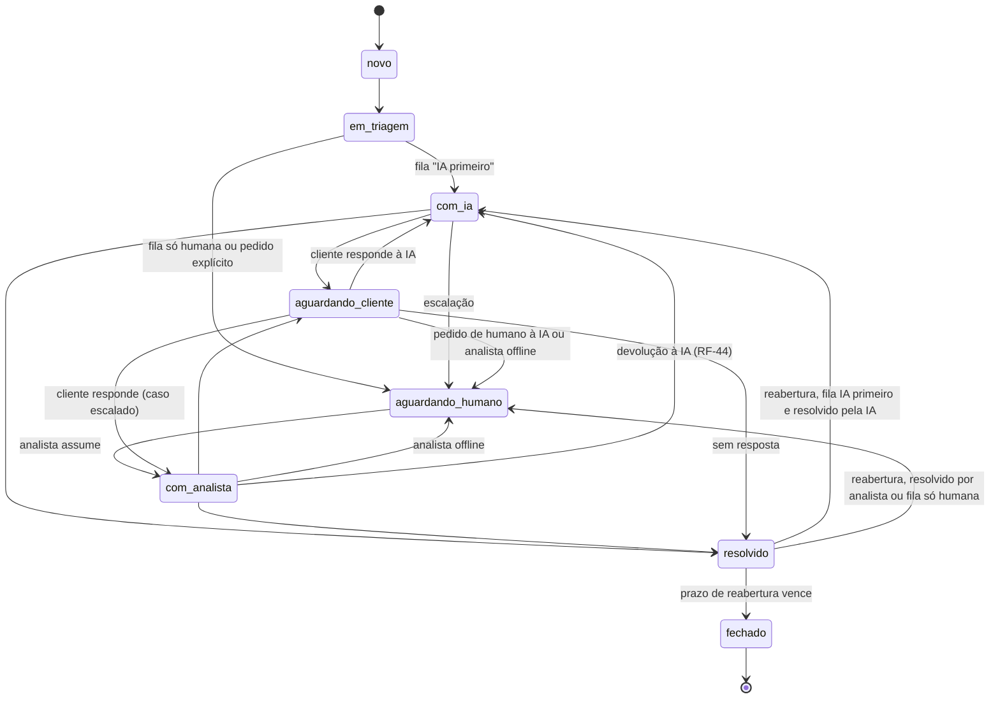

# 06 — Regras de negócio (RN)

As regras de negócio dizem **o que a plataforma decide** em cada situação, independentemente da tecnologia. São 57 RN em 12 temas. Os RF dizem *o que* o sistema faz; as RN dizem *com que critério*.

Todo valor numérico aqui é um **parâmetro configurável** com um valor padrão proposto (seção [Parâmetros](#parâmetros-e-valores-padrão)). Os valores marcados como *proposta* devem ser validados com a CloudWalk no onboarding.

## 1. Identificação do cliente e abertura do atendimento

| ID | Regra | Exemplo | RF |
| --- | --- | --- | --- |
| RN-01 | Todo cliente pertence a **exatamente uma marca**. O mesmo telefone ou e-mail em duas marcas gera dois clientes distintos. | Um telefone que fala com a InfinitePay e com a JIM corresponde a dois `customer_id`. | RF-07, RF-58 |
| RN-02 | Dentro da marca, os identificadores de canal (telefone, e-mail, conta do app) de um cliente são ligados ao mesmo `customer_id`. Um identificador pertence a **um só cliente**. | O lojista fala por WhatsApp e depois por e-mail cadastrado: é reconhecido como o mesmo cliente. | RF-07, RF-51 |
| RN-03 | Um cliente tem no máximo **um atendimento aberto por canal**. Mensagem nova entra no atendimento aberto daquele canal; sem atendimento aberto, um novo é criado. | Segunda mensagem no WhatsApp entra no mesmo atendimento; um e-mail no mesmo dia abre outro atendimento, vinculado ao primeiro. | RF-08, RF-06 |
| RN-04 | Atendimentos abertos do mesmo cliente em canais diferentes são **vinculados**, não fundidos. O atendente vê todos, e cada um responde pelo seu canal de origem. | O analista vê o atendimento do WhatsApp e o do e-mail lado a lado. | RF-06, RF-51 |
| RN-05 | Remetente sem identificador conhecido gera um cliente **não verificado**. Para ele, o atendente só responde dúvidas gerais: consultas de dados de conta (transação, repasse, crédito) exigem cliente verificado. | Um número desconhecido pergunta pelo repasse: a IA pede identificação antes de consultar. | RF-07, RF-32 |

## 2. Ciclo de vida do atendimento

| ID | Regra | Exemplo | RF |
| --- | --- | --- | --- |
| RN-06 | O atendimento só muda de estado pelas **transições do diagrama acima**. Qualquer outra transição é rejeitada e registrada como erro. | Um atendimento `novo` não pode ir direto para `resolvido`. | RF-09 |
| RN-07 | Atendimento em `aguardando_cliente` recebe um **lembrete** após 24 h sem resposta e é **resolvido automaticamente** após 48 h, com motivo "sem resposta do cliente". | O cliente some depois de receber a orientação; dois dias depois o caso é resolvido. | RF-09, RF-48 |
| RN-08 | Atendimento `resolvido` com nova mensagem dentro de **72 h** reabre na mesma fila e mantém o histórico (RN-17). Se a IA resolveu o caso em fila "IA primeiro", ele volta à IA, salvo pedido explícito de humano. Caso resolvido por analista volta para `aguardando_humano`, de preferência para o mesmo analista. A ingestão confere o prazo ao gravar a mensagem. Depois do prazo, fecha o atendimento anterior e abre outro pela RN-09. | O cliente responde "ainda não caiu" no dia seguinte. O mesmo atendimento reabre na mesma fila. | RF-11 |
| RN-09 | `fechado` é **final**. Mensagem nova do cliente abre um novo atendimento, vinculado ao anterior. | Uma semana depois, o cliente volta com o mesmo assunto: novo atendimento, com o anterior no contexto. | RF-08, RF-53 |
| RN-10 | Todo atendimento só pode ser resolvido com um **motivo de resolução** de uma lista configurável. | "Dúvida esclarecida", "problema resolvido", "sem resposta do cliente", "duplicado". | RF-48 |

## 3. Triagem e prioridade

| ID | Regra | Exemplo | RF |
| --- | --- | --- | --- |
| RN-11 | Todo atendimento recebe **uma categoria** de uma lista configurável por marca. Lista inicial: transações e pagamentos, repasses, Pix, crédito, conta digital, maquininha, cadastro, outros. | "Minha maquininha não liga" → maquininha. | RF-10, RF-12 |
| RN-12 | A prioridade tem **quatro níveis**, definidos pelo impacto no negócio do lojista: **crítica** (impedido de vender ou receber), **alta** (dinheiro pendente ou divergente), **média** (dúvida financeira), **baixa** (cadastro ou informação geral). | Maquininha parada → crítica. Repasse não recebido → alta. Dúvida sobre taxa → média. Troca de e-mail → baixa. | RF-10, RF-12 |
| RN-13 | Quando a triagem não consegue classificar, o atendimento recebe categoria **"outros"**, prioridade **média** e vai para a fila padrão da marca. | Mensagem "oi" sem contexto → fila padrão do conjunto de regras da marca (Geral no seed). | RF-12, RF-15 |
| RN-14 | A prioridade **só sobe automaticamente**, nunca desce. Analistas e supervisores podem alterá-la manualmente, em qualquer direção, com motivo registrado na auditoria. | O SLA chegou a 80%: a prioridade sobe de média para alta (RN-25). | RF-10, RF-54 |

## 4. Filas e roteamento

| ID | Regra | Exemplo | RF |
| --- | --- | --- | --- |
| RN-15 | Toda fila pertence a **uma marca e uma equipe**. Regras só apontam para filas **ativas da mesma marca**. | Uma regra da InfinitePay não pode mandar casos para uma fila da JIM. | RF-13, RF-14, RF-17 |
| RN-16 | As regras são avaliadas **na ordem definida** pelo supervisor e **a primeira que casar decide**. Cada marca tem obrigatoriamente uma **fila padrão**, usada quando nenhuma regra casa. | "Crédito acima de R$ 10 mil" vem antes de "Crédito": um caso de R$ 15 mil vai para Crédito VIP. | RF-15 |
| RN-17 | O roteamento acontece em três momentos: **criação** do atendimento, **escalação** e **transferência** manual. Mensagens novas e **reaberturas** (RN-08) não re-roteiam: o caso fica na fila em que estava. | O cliente muda de assunto no meio da conversa: o caso só muda de fila por transferência. | RF-08, RF-28, RF-42 |
| RN-18 | Uma alteração de regra vale **para os roteamentos seguintes**. Atendimentos já enfileirados ficam onde estão, salvo reprocessamento explícito pelo supervisor. | O supervisor cria uma fila nova às 10 h: casos das 9 h continuam na fila antiga. | RF-16, RF-21 |
| RN-19 | Fila com atendimentos abertos **não pode ser excluída**, só desativada. Para desativar, o supervisor indica a fila que recebe os atendimentos abertos e as regras que apontavam para ela. | Desativar "Crédito VIP" exige escolher para onde vão seus 12 casos abertos. | RF-13, RF-17 |
| RN-20 | Toda alteração em fila ou regra gera **uma nova versão**. Versões antigas são imutáveis, e cada decisão de roteamento registra a versão aplicada. | A auditoria mostra: "roteado pela regra 7, versão 3". | RF-18, RF-54 |

## 5. SLA

| ID | Regra | Exemplo | RF |
| --- | --- | --- | --- |
| RN-21 | Cada fila define, **por prioridade**, três prazos: **primeira resposta**, **assunção após escalação** e **resolução**. Valores padrão na seção [Parâmetros](#parâmetros-e-valores-padrão). | Fila Repasses, prioridade alta: 1ª resposta em 5 min, analista assume em 15 min, resolução em 24 h. | RF-13, RF-19 |
| RN-22 | A **resposta da IA conta como primeira resposta**. Por isso existe o SLA separado de **assunção após escalação**, que mede o tempo da escalação até um analista assumir. | A IA responde em 3 s (1ª resposta cumprida); o caso escala e o analista assume em 8 min. | RF-39, RF-45 |
| RN-23 | O relógio do SLA **começa na criação** do atendimento, **pausa** em `aguardando_cliente` e não reinicia em transferências. | O cliente demora 2 h para mandar um comprovante: essas 2 h não contam. | RF-09, RF-28 |
| RN-24 | O padrão é contar **24/7**, porque o suporte da InfinitePay funciona 24 h. Uma fila pode adotar **horário de atendimento** próprio; nesse caso o SLA só corre dentro dele. | Uma fila de casos complexos de crédito atende das 8 h às 20 h: um caso das 22 h começa a contar às 8 h. | RF-13 |
| RN-25 | Ao atingir **80% do prazo**, o atendimento é sinalizado e **sobe um nível de prioridade** (RN-14). | Faltam 3 min de 15 para a 1ª resposta: o caso sobe na fila. | RF-19, RF-60 |
| RN-26 | Ao **estourar** o prazo, o atendimento é marcado como **fora do SLA** de forma permanente e o supervisor da fila é notificado. | O caso aparece no painel operacional em vermelho. | RF-60 |

## 6. Distribuição e atribuição

| ID | Regra | Exemplo | RF |
| --- | --- | --- | --- |
| RN-27 | Um atendimento pode ter **um único atendente responsável**, IA ou analista. Enquanto espera atribuição, o caso fica sob responsabilidade da fila. | Enquanto está com o analista, a IA não responde o cliente (RN-38). | RF-22 a RF-25 |
| RN-28 | Em filas com **"IA atende primeiro"**, todo atendimento novo vai para a IA, exceto quando a categoria é **somente humana** (lista configurável) ou o cliente pede humano já na primeira mensagem. | Uma categoria "suspeita de fraude" configurada como somente humana vai direto para a fila de escalas. | RF-24, RF-39 |
| RN-29 | A ordem dentro da fila é: **prioridade**, depois **menor tempo restante de SLA**, depois **mais antigo**. | Dois casos altos: o que está mais perto de estourar o SLA vem primeiro. | RF-19, RF-45 |
| RN-30 | A atribuição automática só considera analistas **online**, da **equipe da fila** e **abaixo da capacidade** (padrão: 5 atendimentos simultâneos). Entre eles, escolhe o de **menor carga** e, em empate, quem está há mais tempo sem receber caso. A atribuição é **atômica**: dois casos nunca ocupam a mesma última vaga de um analista. | Ana tem 2 casos e Bruno tem 4: o próximo vai para Ana. | RF-25, RF-27 |
| RN-31 | Analista em **pausa** ou **offline** não recebe novos casos. Após **10 min** offline, os casos atribuídos a ele em `com_analista` ou `aguardando_cliente` voltam para `aguardando_humano`. A atribuição é removida e o tempo de SLA já consumido é preservado. | Se o analista voltar antes de vencer o prazo, os casos continuam com ele. | RF-27 |
| RN-32 | A **transferência** exige motivo, preserva o histórico e não reinicia o SLA. | "Transferido para Crédito: cliente pediu aumento de limite." | RF-28 |

## 7. Agente de IA e escalação

| ID | Regra | Exemplo | RF |
| --- | --- | --- | --- |
| RN-33 | A escalação para humano acontece em **seis situações**: (1) o agente decide escalar; (2) o cliente pede humano; (3) a categoria é somente humana; (4) o agente não responde no tempo limite; (5) o evento cai na DLQ; (6) o agente troca **10 mensagens** no atendimento sem resolver. | Depois de 10 trocas sem resolver, a conversa vai para um analista, em vez de girar em círculos. | RF-39, RF-36 |
| RN-34 | O **pedido explícito de humano** é detectado ao gravar a mensagem, por expressões configuráveis por marca e idioma. Se o caso estiver com a IA, inclusive em `aguardando_cliente`, ele escala imediatamente. Na criação ou triagem, o pedido já encaminha o caso para a fila humana, sem abrir turno de IA. Em um caso já na fila humana ou com analista, o pedido entra no histórico do mesmo atendimento. | "Quero falar com uma pessoa" durante a geração invalida o turno em andamento. | RF-39 |
| RN-35 | A IA só executa ações do **catálogo**: responder, consultar dados (simulado), escalar e encerrar. Ações que **movimentam dinheiro ou alteram cadastro** (estorno, limite, troca de conta bancária) são **exclusivas de humanos**. | Um pedido de estorno é escalado; a IA não o executa. | RF-32 |
| RN-36 | A IA só **resolve** um atendimento com confirmação do cliente ("resolveu, obrigado") ou pela regra de inatividade (RN-07). | A IA explica a taxa e pergunta se ajudou; só resolve após o "sim". | RF-32, RF-48 |
| RN-37 | Toda resposta e decisão da IA registra **modelo, versão e configuração** do agente. | Auditoria: "mock-deterministico v0.3, latência 2 s, regras v5". | RF-38, RF-54 |
| RN-38 | A escalação encerra a atribuição à IA e cancela suas entregas que ainda não começaram, já no commit do pedido de handoff (não só quando o worker executa a escalação). Se uma chamada ao canal já começou, a plataforma apura o resultado antes de enviar o aviso de transferência. Exceção: no limite de trocas (RN-33, item 6), as respostas já aplicadas saem antes do aviso; um pedido explícito de humano gravado antes da escalação as cancela mesmo assim. Mensagens seguintes vão para o atendimento humano. Uma devolução explícita do analista abre uma nova atribuição à IA. | Se o cliente pedir humano com uma resposta do bot ainda na fila, recebe o aviso de transferência sem aquela resposta. | RF-39, RF-43, RF-44 |

## 8. Handoff

| ID | Regra | Exemplo | RF |
| --- | --- | --- | --- |
| RN-39 | O resumo do handoff tem **cinco campos obrigatórios**: problema relatado, dados relevantes do cliente, ações já tomadas e seus resultados, motivo da escalação e o que está pendente. | "Repasse de R$ 1.200 do dia 28 não recebido · IA consultou: status pendente · cliente pediu humano · pendente: verificar retenção." | RF-40 |
| RN-40 | O handoff **nunca é bloqueado** pela falta de resumo. Se o resumo não puder ser gerado, o caso escala mesmo assim, com o histórico completo e a marcação "sem resumo". | O agente caiu: o caso chega ao analista com o histórico, sem resumo. | RF-40, RF-41 |
| RN-41 | O caso escalado mantém a prioridade. Escalações por **tempo limite ou falha de integração** sobem um nível, porque o cliente já esperou mais que o normal. | Um caso médio escalado por timeout chega como alto. | RF-42, RF-36 |
| RN-42 | O cliente recebe uma **mensagem padrão de transferência**, configurável por marca e idioma (pt-BR na InfinitePay, inglês na JIM). Ela precede as respostas seguintes do analista e respeita a conciliação de entregas da RN-38. Vale também quando a triagem manda o caso direto para a fila humana (RN-28, fila sem IA). | "Estou te transferindo para um especialista. Ele já recebeu o histórico da nossa conversa." | RF-43 |

## 9. Falhas de integração

| ID | Regra | Exemplo | RF |
| --- | --- | --- | --- |
| RN-43 | Uma entrega com falha **transitória** (5xx, timeout, 429) é repetida **até 5 vezes**, com backoff exponencial (1, 2, 4, 8 e 16 s) e **jitter**. | O broker está reiniciando: o evento é entregue na terceira tentativa. | RF-34 |
| RN-44 | Uma entrega com falha **permanente** (4xx exceto 429, payload fora do contrato) **não é repetida** e vai direto para a DLQ. | Webhook rejeitado por assinatura inválida → DLQ, sem retentativa. | RF-34 |
| RN-45 | Evento **de um turno ainda válido** que chega à DLQ **escala o atendimento** com motivo "falha de integração", e as mensagens seguintes daquela conversa vão direto para o analista. Evento de turno já superado só é auditado, sem escalar. | O evento da mensagem 2 cai na DLQ: o caso escala, e a mensagem 3 vai ao analista, não à IA. | RF-34, RF-39 |
| RN-46 | Cada turno tem **20 s** desde a sua abertura para receber uma ação válida da IA, sem passar do **teto do ciclo: 60 s** desde a **primeira mensagem pendente**. Uma mensagem nova do cliente abre um turno novo com prazo próprio, mas o teto do ciclo não reinicia. Se a publicação do turno falhar de forma definitiva (recusa do broker, contrato inválido ou retentativas esgotadas), o caso escala **na hora**, sem esperar o prazo. A partir do vencimento do turno ou do teto, a plataforma rejeita ações da IA e escala o caso com o histórico mais recente (RN-33). O teto vale mesmo se nenhum turno for publicado. | O cliente escreve aos 0 s e aos 20 s. O turno 2 abre aos 21 s e vale até os 41 s (não 30 s). Com o broker recusando o turno, o caso entra na fila humana em até 2 s após a recusa. Com o mock mudo, em até 22 s após a abertura do turno (RNF-18). | RF-36 |
| RN-47 | Um mesmo `event_id` produz efeito **uma única vez**, por mais vezes que seja entregue. | O mesmo webhook chega duas vezes: o cliente recebe uma resposta. | RF-35 |
| RN-48 | Eventos ficam na DLQ por **no mínimo 7 dias**. Só o supervisor pode reprocessá-los, e o reprocessamento **não reenvia** ao cliente respostas que ele já recebeu. | O bug é corrigido no dia seguinte: o supervisor reprocessa os eventos daquele período. | RF-37 |

## 10. Memória, contexto e dados

| ID | Regra | Exemplo | RF |
| --- | --- | --- | --- |
| RN-49 | O contexto enviado ao atendente contém, nesta ordem: **todas** as mensagens do cliente ainda sem resposta, por inteiro; o histórico do atendimento até **20 mensagens**; o resumo das anteriores, informando até qual mensagem ele cobre; e os resumos dos **últimos 3 atendimentos** do cliente nos **últimos 90 dias**, na mesma marca. Se as mensagens pendentes sozinhas passarem do limite de tamanho, o caso vai para humano com o histórico completo. | Na reabertura, a IA sabe que o cliente reclamou do mesmo repasse há uma semana. | RF-33, RF-53 |
| RN-50 | **Notas internas** nunca são enviadas ao cliente. | "Cliente já ligou três vezes" fica só no painel. | RF-49 |
| RN-51 | Todos os dados da plataforma são **sintéticos**. Telefone, e-mail e documento aparecem **mascarados** em logs. A retenção de conversas é configurável, com prazo a definir junto com a CloudWalk. | Log: `tel=+55 11 9****-**21`. | RF-61 |

## 11. Acesso e auditoria

| ID | Regra | Exemplo | RF |
| --- | --- | --- | --- |
| RN-52 | O analista vê apenas atendimentos das **marcas e equipes dele**. O supervisor vê as marcas sob sua gestão. Nenhum perfil acessa dados de marca não atribuída. | Um analista da JIM não encontra clientes da InfinitePay nem pela busca. | RF-50, RF-59 |
| RN-53 | Só o **supervisor** cria ou altera filas, regras, equipes, atendentes, SLAs e listas configuráveis. | Um analista não vê a tela de regras. | RF-13, RF-14, RF-22, RF-59 |
| RN-54 | A auditoria é **imutável**: ninguém altera nem apaga eventos. Uma correção é um novo evento. Todo evento registra **quem** (usuário, IA ou sistema), **quando**, **o quê**, o atendimento, o `trace_id` e, se houver, a versão da regra. | Uma prioridade alterada errada é corrigida por novo evento, e os dois ficam visíveis. | RF-54, RF-55, RF-56 |

## 12. Turnos da IA (cliente que escreve durante o atendimento)

Um **turno** é um envio de contexto ao agente e a resposta que ele gera. Cada atendimento tem um número de turno que só cresce. O fluxo técnico está no [07, seção 3.4](07-arquitetura.md#34-cliente-que-escreve-enquanto-a-ia-responde-turnos).

| ID | Regra | Exemplo | RF |
| --- | --- | --- | --- |
| RN-55 | A plataforma **agrupa mensagens em rajada**. O turno fica elegível após **1,5 s** sem nova mensagem ou **4 s** desde a primeira mensagem pendente, o que vier primeiro. A janela é configurável por canal e vale **0** para e-mail. | A mensagem 2 é gravada aos 3 s. Se a primeira continua pendente, o próximo turno fica elegível aos 4 s. | RF-29, RF-33 |
| RN-56 | A plataforma aplica **uma ação final por turno**, antes do prazo da RN-46, se o turno for o atual, pertencer à mesma atribuição à IA e cobrir a última mensagem do cliente gravada. A gravação de uma mensagem nova invalida imediatamente os turnos com contexto anterior. Respostas inválidas são descartadas e auditadas, preservando qualquer resultado terminal já gravado. | A mensagem 2 é gravada aos 3 s. A resposta do turno 1 chega aos 3,5 s e é rejeitada, ainda que o turno 2 não tenha saído. | RF-31, RF-33, RF-54 |
| RN-57 | Após **15 s** desde a primeira mensagem pendente, a plataforma agenda **um aviso de progresso por ciclo**, se o caso ainda estiver pendente com a IA. No vencimento do turno ou do teto de **60 s**, vale a RN-46 e o caso segue para a fila humana com o histórico mais recente. | O cliente escreve a cada 2 s. Se o caso continuar pendente, recebe o aviso aos 15 s e, no teto de 60 s, entra na fila humana, onde aguarda um analista. | RF-31, RF-36, RNF-05 |

## Parâmetros e valores padrão

Todos são configuráveis. Os de origem *proposta* são escolhas deste projeto, a validar com a CloudWalk.

| Parâmetro | Padrão | Origem | RN |
| --- | --- | --- | --- |
| Lembrete em `aguardando_cliente` | 24 h | Proposta | RN-07 |
| Resolução automática por inatividade | 48 h | Proposta | RN-07 |
| Prazo de reabertura | 72 h | Proposta | RN-08 |
| Gatilho de alerta de SLA | 80% do prazo | Proposta | RN-25 |
| Capacidade por analista | 5 atendimentos simultâneos | Proposta | RN-30 |
| Capacidade do agente de IA (bot) | 1.000 atendimentos simultâneos, configurável pelo supervisor | Proposta | RN-30 |
| Offline antes de devolver casos à fila | 10 min | Proposta | RN-31 |
| Trocas da IA sem resolução antes de escalar | 10 trocas. Uma troca é um turno com `reply` aplicado na atribuição atual da IA; `escalate`, `resolve` e ações rejeitadas não contam, e a `resolve` e o handoff zeram a contagem. Parâmetro em `Handoff::Policy#exchanges_limit` | Proposta, implementada no bloco 10 | RN-33 |
| Aviso de transferência ao cliente | pt-BR: "Estou te transferindo para um especialista. Ele já recebeu o histórico da nossa conversa." Inglês: "I'm transferring you to a specialist. They already have the history of our conversation." Em `Handoff::Policy`, configurável por marca no bloco 12 | Proposta, implementada no bloco 10 | RN-42 |
| Expressões de pedido de humano | Por idioma em `Handoff::Policy`, sem acento nem maiúsculas, trecho a trecho da mensagem. O pedido precisa citar um humano ("quero falar com um atendente", "me passa pra uma pessoa", "atendimento humano", "atendente", "talk to a human", "human please"); trecho negado não conta ("não quero falar com atendente"), e vontade de conversar não basta ("quero conversar sobre a taxa", "preciso de atendimento"). Configuráveis por marca no bloco 12 | Proposta, implementada no bloco 10 | RN-34 |
| Prioridade sem triagem na escalação | Vale a média da RN-13; a escalação por tempo ou falha de integração a leva a alta. Com a triagem (bloco 11), vale a prioridade definida por ela | Proposta, implementada no bloco 10 | RN-41 |
| Palavras da triagem | Por idioma em `Triage::Policy` (pt-BR e inglês), sem acento nem maiúsculas, palavra inteira. Vence a categoria com mais palavras no texto e, no empate, a mais específica. Prioridade = a mais alta entre a base da categoria (cadastro baixa, demais média) e as palavras de impacto da RN-12 ("não liga", "parada", "não consigo vender" → crítica; "não caiu", "não recebido" → alta). Configuráveis por marca no bloco 12 | Proposta, implementada no bloco 11 | RN-11, RN-12 |
| Tags da triagem | `urgente`, `reclamacao`, `fraude`, por palavra-chave e idioma | Proposta, implementada no bloco 11 | RF-10 |
| Categorias somente humanas | `cadastro` (RN-35: alterar cadastro é só de humano). Configurável por marca no bloco 12 | Proposta, implementada no bloco 11 | RN-28 |
| Tempo limite do agente por turno | 20 s desde a abertura do turno, limitado ao teto do ciclo. Configurável por marca (bloco 12) | Proposta ([ADR-020](08-decisoes-de-arquitetura.md#adr-020--prazo-da-ia-por-turno-com-teto-do-ciclo)); calibrar com o p95 do agente real | RN-46 |
| Teto do ciclo com a IA | 60 s desde a primeira mensagem pendente, sem reiniciar. Configurável por marca (bloco 12) | Proposta ([ADR-020](08-decisoes-de-arquitetura.md#adr-020--prazo-da-ia-por-turno-com-teto-do-ciclo)) | RN-46 |
| Retentativas | 5, com backoff 1, 2, 4, 8, 16 s e jitter | RNF-16 | RN-43 |
| Retenção mínima da DLQ | 7 dias | RNF-16 (prazo de reentrega do WhatsApp) | RN-48 |
| Contexto do atendente | Todas as mensagens pendentes + 20 de histórico + 3 atendimentos em 90 dias. Limite de 16 000 caracteres nas pendentes e 32 000 no contexto inteiro (os resumos de atendimentos anteriores contam no limite) | Proposta | RN-49 |
| Janela de agrupamento de mensagens | 1,5 s (chat e WhatsApp), 0 (e-mail), no máximo 4 s após a primeira mensagem pendente. Com janela 0, `dispatch_due_at` é o horário da gravação e o turno sai na volta seguinte do `scheduler` (até 250 ms). Canal sem janela definida na política da marca é erro na ingestão: nada é gravado | Proposta | RN-55 |
| Aviso de progresso ao cliente | 15 s após a primeira mensagem pendente, um por ciclo. Texto padrão por idioma em `Turns::Policy` (pt-BR: "Ainda estou verificando as informações para te responder. Só mais um instante."), configurável por marca no bloco 12 | Proposta, implementada no bloco 08 | RN-57 |
| Horário de contagem do SLA | 24/7 | Suporte 24 h da InfinitePay | RN-24 |

### SLA padrão por prioridade (proposta)

| Prioridade | 1ª resposta | Assunção após escalação | Resolução |
| --- | --- | --- | --- |
| Crítica | 1 min | 5 min | 4 h |
| Alta | 5 min | 15 min | 24 h |
| Média | 15 min | 1 h | 48 h |
| Baixa | 1 h | 4 h | 5 dias |

A primeira resposta é curta porque a IA atende primeiro (RN-22). O prazo que exige gente é a **assunção após escalação**.

## Perguntas para o onboarding com a CloudWalk

- Quais são os SLAs reais por prioridade e por marca?
- Existe lista oficial de categorias e de categorias que só humanos podem atender?
- Quais ações a IA real pode executar sozinha e quais exigem humano?
- Qual é o prazo de retenção de conversas exigido pelo jurídico?
- A JIM funciona 24/7 como a InfinitePay?
- O agente atual recebe mensagens uma a uma ou agrupadas? Qual janela de agrupamento a operação considera aceitável?
