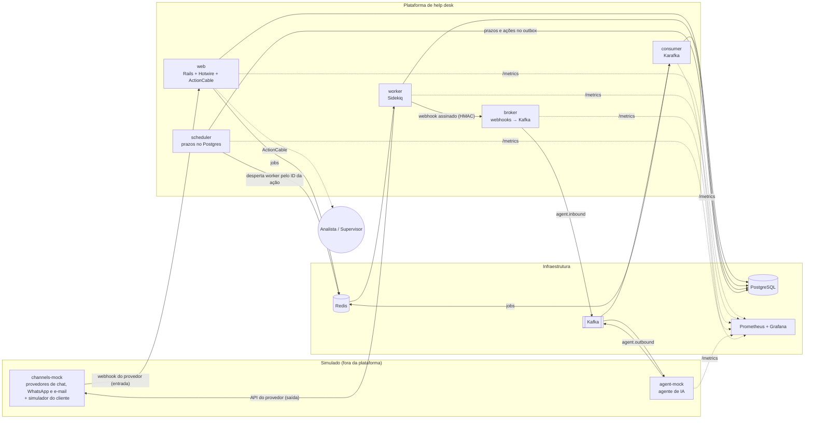
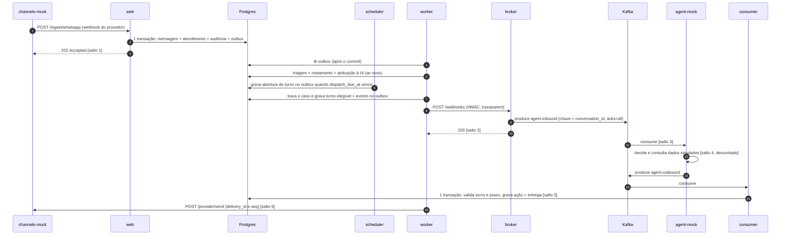
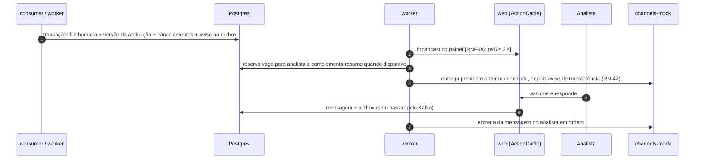
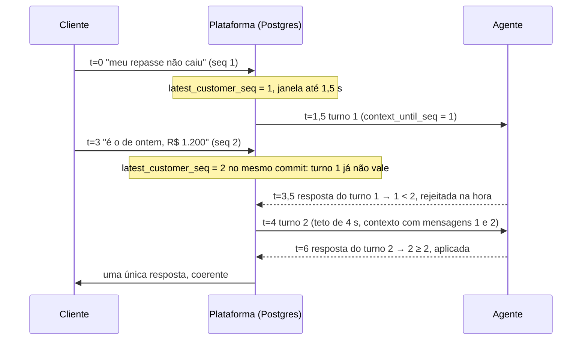
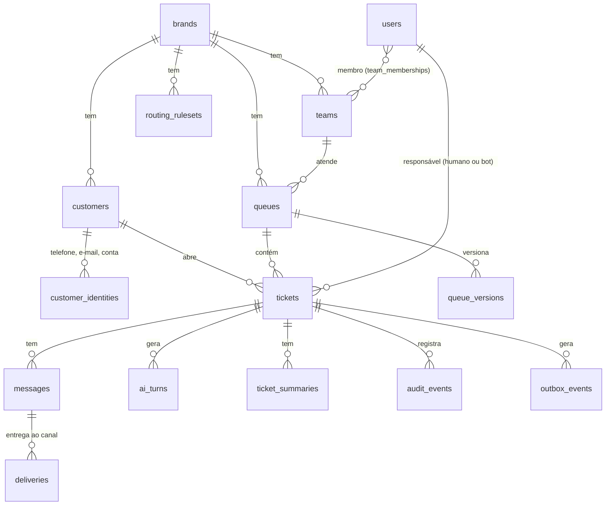

# 07 — Arquitetura

Este documento descreve **como as peças se conectam**: componentes, fluxo das mensagens, modelo de dados, contratos e o que acontece quando algo falha. As tecnologias e o motivo de cada uma estão em [08 — Decisões de arquitetura](08-decisoes-de-arquitetura.md).

O fluxo do agente e as opções de leitura sob demanda, busca de conhecimento e avaliação estão em [09 — Evolução da integração com a IA](09-evolucao-da-integracao-com-ia.md).

Cada seção traz um bloco **Por quê**, ligando a escolha aos requisitos ([04 — RF](04-requisitos-funcionais.md), [05 — RNF](05-requisitos-nao-funcionais.md)) e às regras ([06 — RN](06-regras-de-negocio.md)).

**Stack:** Rails 8 + Hotwire · Apache Kafka 4.x (KRaft) com Karafka · Sidekiq + Redis · PostgreSQL · broker de webhooks, agente mock e canais simulados em Ruby · OpenTelemetry, Prometheus e Grafana · Docker Compose.

## 1. Princípios

Seis princípios guiam todas as decisões abaixo. Quando houver dúvida na implementação, eles desempatam.

| # | Princípio | O que significa na prática | Requisitos |
| --- | --- | --- | --- |
| P1 | **Confirmar rápido, processar depois** | A ingestão grava e responde. Triagem, roteamento e envio ao agente acontecem fora da requisição | RNF-01, RNF-10 |
| P2 | **O Postgres é a fonte da verdade** | Redis e Kafka podem perder ou repetir dados: tudo o que importa pode ser reconstruído a partir do banco | RNF-14, RNF-19 |
| P3 | **Entrega pelo menos uma vez + idempotência** | Toda mensagem pode chegar duas vezes. Todo consumidor ignora `event_id` repetido | RF-35, RN-47 |
| P4 | **O agente de IA é um usuário** | O agente tem cadastro do tipo bot, recebe atendimentos atribuídos e é auditado como um analista | RF-23, RN-27 |
| P5 | **Configuração é dado versionado** | Filas e regras moram no banco, com versão. Nada de regra em código | RF-16, RF-18, RN-20 |
| P6 | **Tudo carrega `trace_id`** | Cada salto propaga o `traceparent`, e auditoria, logs e eventos usam o mesmo ID | RF-56, RNF-20 |

**Por quê.** O TAPI avalia a "robustez da integração diante de falhas, reentregas e picos". Os três primeiros princípios são a resposta padrão de mercado a isso: o Stripe e a Meta (WhatsApp) recomendam responder logo e processar depois, e entregam webhooks "pelo menos uma vez", exigindo deduplicação (referências no [05](05-requisitos-nao-funcionais.md)). P4 vem direto do TAPI: o agente "interage na plataforma como se fosse um humano". P5 vem da exigência de filas "editáveis pela própria operação, sem depender de desenvolvimento".

## 2. Componentes



| Contêiner | Responsabilidade | Escala como | Por que é separado |
| --- | --- | --- | --- |
| `web` | Endpoints de ingestão dos canais, painel do analista, telas de configuração, auditoria, ActionCable | Réplicas sem estado atrás do proxy | É o único ponto de entrada HTTP. Sem estado, então escala só com réplicas |
| `worker` | Publicar o outbox, triagem e roteamento, atribuição, disparo de webhooks, entrega ao canal, timers de SLA e de timeout | Mais processos Sidekiq | Tira da requisição tudo o que é lento ou pode falhar (P1) |
| `consumer` | Consumir `agent.outbound`, aplicar a ação do agente ao atendimento, alimentar a DLQ do painel | Até o número de partições (48) | Consumir Kafka é um laço contínuo, diferente de jobs. Separar permite medir e escalar à parte (E5) |
| `broker` | Receber o webhook da plataforma, validar HMAC e contrato, publicar em `agent.inbound` | Réplicas sem estado | Reproduz o broker do desenho atual da CloudWalk ([ADR-007](08-decisoes-de-arquitetura.md#adr-007--broker-de-webhooks-como-serviço-separado)) |
| `agent-mock` | Consumir `agent.inbound`, decidir (responder, consultar, escalar, encerrar), publicar em `agent.outbound` | Até o número de partições (48). Ver a capacidade na seção 7 | Simula o contrato do agente real ([ADR-008](08-decisoes-de-arquitetura.md#adr-008--agente-de-ia-mock-determinístico)) |
| `scheduler` | Consultar prazos no Postgres a cada 250 ms e gravar ações vencidas no outbox | Uma réplica no Compose. Réplicas concorrentes podem dividir os lotes com `SKIP LOCKED` | Prazos e ações sobrevivem a reinícios e à perda do Redis ([ADR-016](08-decisoes-de-arquitetura.md#adr-016--prazos-do-atendimento-e-ações-duráveis-no-outbox)) |
| `channels-mock` | Fazer o papel dos provedores (app, WhatsApp, e-mail): enviar webhooks de entrada e receber as respostas. Hospeda o simulador do cliente (RF-04) | Uma instância | A plataforma nunca fala direto com o cliente, só com o provedor ([ADR-012](08-decisoes-de-arquitetura.md#adr-012--canais-simulados-como-provedores-externos)) |
| `postgres` | Fonte da verdade: atendimentos, mensagens, configuração, outbox, auditoria | Vertical | P2 |
| `redis` | Filas do Sidekiq, pub/sub do ActionCable, contadores do rate limit | Vertical | [ADR-005](08-decisoes-de-arquitetura.md#adr-005--jobs-assíncronos-com-sidekiq--redis) |
| `kafka` | Tópicos `agent.inbound`, `agent.outbound`, `agent.dlq` | Partições | [ADR-004](08-decisoes-de-arquitetura.md#adr-004--mensageria-com-apache-kafka-4x-kraft) |
| `prometheus`, `grafana` | Métricas e painéis do experimento | — | RNF-22 |

### Filas do Sidekiq

| Fila | Peso | Jobs | Por que essa prioridade |
| --- | --- | --- | --- |
| `critical` | 6 | Publicação do outbox, abertura de turno, fallback de IA, disparo do webhook ao broker, entrega ao canal | Estão no caminho da resposta ao cliente ou da escalação (RNF-03, RNF-18) |
| `default` | 3 | Triagem, roteamento, atribuição, handoff e resumo | Decidem para onde o caso vai, mas não seguram a resposta da IA |
| `timers` | 2 | Aviso de progresso, alertas de SLA, inatividade e analista offline | O `scheduler` registra a ação no Postgres quando o prazo vence. O Sidekiq executa a partir do ID da ação |
| `low` | 1 | Varreduras de segurança, resumos de resolução, métricas agregadas | Podem esperar |

**Por quê.** Separar por fila com peso evita que uma rajada de jobs lentos (por exemplo, resumos) atrase a resposta ao cliente durante o pico do E1.

## 3. Fluxo de mensagens

Os números entre colchetes são os **saltos** do orçamento de latência do [05, seção 2](05-requisitos-nao-funcionais.md#orçamento-de-latência-do-fluxo-cliente--agente--cliente).

### 3.1 Ida e volta com o agente (caminho feliz)



Passo a passo:

1. **Ingestão.** O `web` valida e normaliza o webhook e identifica a marca e o cliente (RF-05, RN-01, RN-02). Na mesma transação, cria ou reaproveita o atendimento (RN-03, RN-08), trava sua linha (`SELECT ... FOR UPDATE`), deduplica a mensagem, atribui o próximo `seq`, atualiza `latest_customer_seq` e grava a auditoria e o outbox. Se o caso estiver com a IA, atualiza os prazos da seção 3.4 ou aplica o pedido explícito de humano (RN-34). O `202` sai após o commit. A partir desse commit, respostas montadas com contexto anterior perdem a validade.
2. **Triagem e roteamento.** O worker classifica o caso novo (RF-12, RN-11 a RN-13) e registra a fila e a versão das regras aplicadas (RN-16, RN-20). Em fila "IA primeiro", atribui ao bot e grava os prazos do ciclo, contados desde a primeira mensagem pendente. Pedido de humano ou categoria somente humana leva o caso à fila humana (RN-28, RN-34).
3. **Envio ao agente.** Quando `dispatch_due_at` vence, o `scheduler` grava a ação de abertura no outbox. O worker trava o atendimento, confirma o prazo e a versão da ação, monta o contexto com todas as mensagens pendentes e grava o turno `eligible` e seu evento no outbox na mesma transação. O publicador dispara o webhook ao broker. Retentativas reenviam **o mesmo conteúdo e o mesmo `event_id`**. Ver a seção 3.4.
4. **Broker.** Valida a assinatura e o contrato e publica em `agent.inbound`. Só responde `200` depois de o Kafka confirmar a escrita.
5. **Agente.** O mock decide, executa consultas simuladas (as "tools") e publica a ação em `agent.outbound`.
6. **Aplicação da resposta.** O consumer deduplica por `event_id` (RN-47), trava a linha do atendimento e valida prazo, atribuição e contexto com os dados do turno gravado (seção 3.4). A mesma transação grava o resultado, a auditoria (RN-37) e, quando a ação tiver texto para o cliente (`reply.text` ou `resolution.text`), a mensagem de saída, a entrega (`deliveries`, `pending`) e o item `delivery.requested` no outbox (`dedup_key = delivery:<delivery_id>`). `escalate` não gera saída da IA: o aviso de transferência vem do handoff (bloco 10).
7. **Entrega.** O worker entrega as saídas na ordem do atendimento (seção 3.2), com `delivery_id` estável nas retentativas. O `channels-mock` guarda o resultado por `delivery_id`, em memória enquanto o processo vive (até 1.000 envios), e devolve a mesma confirmação quando ela se perde ([ADR-021](08-decisoes-de-arquitetura.md#adr-021--entrega-ao-canal-identidade-aceite-e-conciliação)).

**Por quê de cada passo.**

- **Transação única na ingestão (passo 1):** se o `web` cair entre gravar a mensagem e avisar o worker, o outbox garante que o aviso não se perde (RNF-14). Sem isso, existiria uma janela em que a mensagem está salva mas ninguém a processa.
- **Roteamento no worker, não na ingestão (passo 2):** a avaliação de regras consulta configuração e pode crescer. Manter fora da requisição preserva o ack em p95 ≤ 200 ms (RNF-01).
- **Webhook para o broker em vez de publicar direto no Kafka (passo 3):** é o desenho atual da CloudWalk, e o TAPI avalia a aderência a ele ([ADR-007](08-decisoes-de-arquitetura.md#adr-007--broker-de-webhooks-como-serviço-separado)).
- **Broker só responde depois do Kafka (passo 4):** se respondesse antes, uma queda do broker perderia a mensagem já confirmada.
- **Chave `conversation_id` (passo 4).** Os eventos de uma conversa caem na mesma partição, que preserva a ordem de publicação. Sidekiq e retentativas podem publicar o turno 1 depois do turno 2. A aplicação da resposta segue o `seq` e o estado no Postgres (RNF-13, seção 3.4).
- **Tools do lado do agente (passo 5):** no desenho da CloudWalk, o agente "consulta sistemas internos por meio de ferramentas". A plataforma só recebe o resultado e o registra na auditoria.
- **Resposta volta por tópico (passo 6):** o TAPI diz que "as respostas seguem o caminho inverso". Usar o tópico também absorve picos de resposta do agente.
- **Validar com a linha travada (passo 6):** se o cliente escreveu depois do contexto, se o timeout já escalou o caso ou se o caso passou por um humano e voltou à IA, a resposta é descartada e auditada. O cliente não recebe duas vozes nem uma resposta que ignora o que ele acabou de dizer (RN-27, RN-38, RN-56).

### 3.2 Escalação e handoff



**Gatilhos.** A RN-33 cobre decisão do agente, pedido de humano (RN-34), categoria somente humana (RN-28), vencimento do prazo do atendimento (RN-46), DLQ de turno ainda válido (RN-45) e limite de trocas da IA. Em `novo` ou `em_triagem`, o pedido explícito fica registrado na ingestão e a triagem encaminha direto à fila humana. Em `com_ia` ou `aguardando_cliente` com a IA, a ingestão aplica a escalação imediatamente. Em `aguardando_humano` ou com analista, registra o pedido no histórico do caso existente.

**Entrada na fila e resumo são medidos separadamente.** O caso entra na fila de escalas com o histórico acessível desde o primeiro instante (RNF-06: p95 ≤ 2 s). O resumo pode chegar depois, com meta própria, sem segurar a entrada na fila (RN-40).

**Resumo do handoff** (RN-39, RN-40): quando o agente escala, ele envia o resumo com os cinco campos na própria ação `escalate`. Quando a escalação vem da plataforma (timeout, DLQ, regra), o worker monta um resumo a partir do histórico e das tools já registradas. Se nada disso for possível, o caso escala mesmo assim, marcado "sem resumo".

**Transferência e ordem de entrega.** Sob o lock do atendimento, o handoff grava a fila humana, incrementa `assignment_version`, encerra o ciclo da IA, audita e registra o aviso padrão da RN-42 no outbox. Entregas `pending` da atribuição antiga à IA, incluindo o aviso de progresso, passam a `cancelled`. Cada saída usa o `seq` da mensagem e um `delivery_id` estável. Sob o mesmo lock, o worker só autoriza a entrega da primeira saída não encerrada, marcando-a `sending` antes da chamada HTTP. Se o worker autorizou a chamada primeiro, o handoff mantém essa entrega em conciliação. O caso fica disponível ao analista imediatamente. **Handoff mínimo (bloco 08).** Todo gatilho (prazo do turno, teto do ciclo, falha definitiva, DLQ) chama `Handoff::Request` com o atendimento travado: grava `handoff.requested` no outbox com a chave `handoff:<ticket>:<assignment_version>` (o segundo gatilho na mesma atribuição colide e não grava nada) e zera `progress_due_at`. O worker (`Handoff::Escalate`) trava o atendimento, revalida a atribuição e o estado e então escala para a fila padrão ativa da marca com `queue_version`: `aguardando_humano`, `assignee` nulo, `assignment_version + 1`, ciclo encerrado, turnos `eligible` em `expired` e entregas `pending` da IA em `cancelled`. Sem fila padrão, escala sem fila e audita `queue_missing`. Descartes auditados em `handoff.discarded`: `atribuicao_mudou`, `ja_escalado`, `fora_da_ia`, `turno_applied` e `atendimento_inexistente`. O handoff só é um por atribuição enquanto toda volta do caso à IA incrementar `assignment_version` (invariante que o bloco 10 precisa manter). O aviso da RN-42, o resumo e o analista entram no bloco 10. O aviso de transferência e as mensagens seguintes ao cliente aguardam um resultado definitivo da entrega anterior.

Uma confirmação perdida mantém a saída em `sending`. O worker consulta o resultado repetindo a chamada com o mesmo `delivery_id`. O `channels-mock` persiste o efeito e a confirmação juntos, deduplica esse ID e rejeita uma nova entrega com `seq` anterior ao último aceito na conversa, ou igual a ele com outro `delivery_id`. A recuperação retoma uma tentativa abandonada após vencer sua reserva: a reserva da tentativa (`deliveries.lease_until`) também é o despertador do item no outbox. A sequência avança após confirmação, cancelamento antes da chamada ou rejeição definitiva. Se as retentativas esgotarem com resultado ainda incerto, a pendência fica visível para conciliação no painel. A fila humana e o histórico continuam disponíveis durante essa espera. Nesse caso, o item do outbox é encerrado com `last_error = reconciliation_needed`; a entrega fica em `sending`, sem reserva, e bloqueia as saídas seguintes do atendimento até a conciliação. Cada tentativa transitória é classificada em `delivery.retry_scheduled.outcome`: `sem_efeito` (conexão recusada, falha de DNS, tempo esgotado ao abrir a conexão, `503` ou `429` do provedor) ou `incerto` (tempo de leitura esgotado, conexão cortada depois do envio, outro `5xx`, `2xx` sem `message_id`, tentativa abandonada). Se todas foram `sem_efeito`, a entrega vira `failed` (`provedor_indisponivel`) e a fila avança. Falha da própria plataforma antes do envio (sem adaptador, sem conta, corpo fora do contrato `chat_send`) é `failed` com `reason: plataforma`, sem chamar o provedor. Respostas `4xx` do provedor são rejeição definitiva, exceto `429`, que é transitório (RN-43). Ver o [ADR-021](08-decisoes-de-arquitetura.md#adr-021--entrega-ao-canal-identidade-aceite-e-conciliação).

**Por quê.**

- **O analista responde pela plataforma, não pelo Kafka:** o tópico existe para integrar um sistema externo (o agente). O analista é usuário do próprio help desk, então passar pelo Kafka só adicionaria latência e pontos de falha.
- **Resumo gerado pelo agente, com fallback.** A plataforma tenta gerar um resumo do histórico quando o agente está indisponível. Se o resumo faltar, registra o motivo. O caso entra na fila com o histórico acessível em ambos os cenários (RN-40, RNF-06).
- **Roteamento de novo na escalação:** a fila de entrada da IA não é necessariamente a da equipe humana certa (RF-42). Por isso a escalação é um dos três momentos de roteamento (RN-17).
- **Broadcast por ActionCable:** o caso aparece no painel sem o analista recarregar, condição para o p95 ≤ 2 s do RNF-06.

### 3.3 Mensagens novas durante o atendimento

| Estado do atendimento | O que acontece com a nova mensagem do cliente |
| --- | --- |
| `com_ia`, `aguardando_cliente` (caso com a IA) | Segue o fluxo 3.1. Pedido explícito encaminha para `aguardando_humano` no commit da ingestão |
| `aguardando_humano`, `com_analista`, `aguardando_cliente` (caso com analista) | Entra no histórico humano e aparece no painel. Se o responsável estiver offline pelo prazo da RN-31, o caso volta a `aguardando_humano` e libera a vaga |
| `resolvido`, dentro de 72 h | Reabre o atendimento pela RN-08. Pedido explícito de humano segue para a fila humana sem reatribuição à IA |
| `fechado` | Abre um novo atendimento, vinculado ao anterior (RN-09) |

**Por quê.** O estado e a atribuição decidem qual atendente atua no caso. Em `aguardando_humano`, a fila é responsável até a próxima atribuição (RN-27).

### 3.4 Cliente que escreve enquanto a IA responde (turnos)

**O problema.** No WhatsApp, as pessoas escrevem em rajadas. Se a IA respondesse a cada mensagem isolada, responderia à primeira sem ter visto a segunda ("qual repasse?" depois de o cliente já ter dito "o de ontem, R$ 1.200"), e o cliente receberia respostas cruzadas.

**A ideia central.** A janela de agrupamento só **reduz** o problema, juntando mensagens próximas. A **garantia** vem do Postgres: toda mensagem nova do cliente, ao ser gravada, invalida na mesma transação qualquer resposta montada sem ela. O marco é o **commit** da mensagem na plataforma: se ela foi persistida antes de a resposta ser aplicada, a resposta precisa cobri-la; se foi persistida depois, ela abre a continuação da conversa. O momento em que o cliente digitou ou em que o canal entregou não importa, só o momento em que a plataforma conseguiu gravar.

**Estado no atendimento e no turno.**

| Campo | Onde | Para quê |
| --- | --- | --- |
| `latest_customer_seq` | `tickets` | Última mensagem do cliente gravada. Atualizado na transação da ingestão, com a linha travada |
| `first_pending_seq`, `first_pending_at` | `tickets` | Identidade e horário da primeira mensagem do ciclo pendente. Junto à versão da atribuição, distinguem avisos e timeouts de ciclos diferentes |
| `dispatch_due_at` | `tickets` | Quando o próximo turno deve sair (fim da janela de agrupamento) |
| `context_version` | `tickets` | Versão do contexto do próximo turno. Começa em 0 e sobe 1 em toda gravação que muda o que a IA veria: mensagem do cliente (ingestão) e mensagem de saída visível ao cliente (resposta aplicada, analista). Sobe na mesma transação, com a linha travada (bloco 06). Não sobe em duplicata, rejeição, descarte, `escalate` nem `resolve` sem texto. Sobe também com o caso fora da IA, porque muda o que a IA veria quando o caso voltar |
| `progress_due_at`, `ai_deadline_at` | `tickets` | Aviso aos 15 s e teto do ciclo aos 60 s desde `first_pending_at`. Continuam valendo durante toda a espera, inclusive sem turno publicado |
| `assignment_version` | `tickets` | Muda a cada troca de responsável (IA → humano → IA). Invalida respostas de uma atribuição anterior |
| `ai_turns` | tabela própria | Um registro por turno: `turn`, contexto enviado, `context_version` e `context_digest` (SHA-256 do JSON canônico do contexto enviado, para provar que o turno gravado é o que a IA recebeu; forma canônica no [ADR-022](08-decisoes-de-arquitetura.md#adr-022--versão-e-prova-do-contexto-do-turno)), `context_until_seq`, `assignment_version`, `event_id`, `status` (`eligible`, `applied`, `superseded`, `expired`) e `deadline_at`, o prazo do turno: o menor entre a abertura + 20 s e o `ai_deadline_at` do atendimento ([ADR-020](08-decisoes-de-arquitetura.md#adr-020--prazo-da-ia-por-turno-com-teto-do-ciclo)) |

**Condições para aplicar uma resposta.** O consumer trava a linha do atendimento e confere a resposta com o turno registrado no Postgres:

1. A resposta aponta para o turno atual, em `eligible`, e `in_reply_to` corresponde ao `event_id` persistido para ele.
2. A `assignment_version` devolvida corresponde à versão do turno e à atribuição atual, que continua com a IA.
3. O `context_until_seq` devolvido corresponde ao do turno persistido. O valor persistido cobre o `latest_customer_seq` do atendimento.
4. O ciclo ainda está pendente e o relógio do banco, lido após adquirir o lock, está antes do `deadline_at` do turno (que nunca passa de `tickets.ai_deadline_at`). Essa verificação vale mesmo com o job de timeout atrasado.

O relógio é lido com `clock_timestamp()` depois do lock (`now()` fica parado no início da transação). A resposta é rejeitada quando esse instante é maior ou igual ao menor entre `ai_turns.deadline_at` e `tickets.ai_deadline_at`. Motivos auditados em `agent_action.rejected`: `turno_inexistente`, `in_reply_to_divergente`, `turno_nao_elegivel`, `turno_superado`, `prazo_vencido`, `atribuicao_mudou`, `fora_da_ia`, `contexto_divergente` e `ciclo_encerrado` (bloco 04), e `handoff_pedido` (bloco 08): já existe um pedido de handoff na atribuição atual. É o último critério, então um turno vencido ou expirado mostra o motivo do prazo. `ai_turns.response` só é gravado quando `turn` e `in_reply_to` correspondem ao turno persistido.

O turno fica `eligible` no commit que grava seu evento no outbox. A confirmação do broker atualiza o estado da publicação separadamente. Se todas as condições forem satisfeitas, a mesma transação marca o turno `applied`, registra a ação final, limpa os prazos e cancela o aviso de progresso do ciclo que ainda estiver `pending`. Ao receber outra mensagem, a plataforma abre um novo ciclo com a primeira mensagem ainda pendente. Uma resposta descartada gera auditoria com o motivo e as consultas validadas, preservando o estado do turno. As transições para `superseded` ou `expired` partem de `eligible` quando a ingestão, a troca de atribuição, o timeout ou o handoff (bloco 08) invalidam o turno. `applied`, `superseded` e `expired` são estados terminais.

**Regras de tempo** (RN-55 a RN-57, RN-46):

| Momento | O que acontece |
| --- | --- |
| Cada mensagem nova enquanto o caso está com a IA | `dispatch_due_at` é o menor entre a hora da mensagem mais a janela do canal e `first_pending_at` + **4 s**. É o instante de elegibilidade, sujeito ao atraso medido do scheduler e do worker. Com janela 0 (e-mail), `dispatch_due_at` é a hora da gravação e nunca fica antes dela, mesmo depois do teto; o turno sai na volta seguinte do `scheduler` |
| Pedido explícito de humano | Detectado na ingestão. Aplica a transição da seção 3.2 (RN-34) |
| 15 s desde `first_pending_at` | O `scheduler` registra uma ação de aviso por ciclo. O worker registra a entrega do aviso somente enquanto o mesmo ciclo estiver pendente, com a IA e antes do timeout |
| 20 s desde a abertura do turno (`ai_turns.deadline_at`) | Respostas desse turno passam a ser rejeitadas. O `scheduler` registra uma ação de handoff. O worker confirma que o turno segue elegível e o ciclo pendente e aplica a escalação com o histórico mais recente (RN-46) |
| 60 s desde `first_pending_at` (`ai_deadline_at`, teto do ciclo) | Vale mesmo sem turno publicado ou com o cliente ainda escrevendo. Mesma ação de handoff (RN-46) |
| Pedido de handoff gravado (`handoff.requested`) | Na mesma transação, os turnos `eligible` da atribuição expiram (`ai_turn.expired` com o motivo do pedido) e `progress_due_at` zera. Do commit do pedido até o `Handoff::Escalate`, a atribuição não abre turno (`ai_turn.not_opened`, `handoff_pedido`), não aplica ação da IA (`agent_action.rejected`, `handoff_pedido`) nem envia aviso (`progress.notice_discarded`, `handoff_pedido`). O `Escalate` descarta o pedido cujo turno já foi aplicado (`turno_applied`) |
| Falha definitiva da publicação do turno | Recusa do broker (`401`, `422`), contrato inválido ou retentativas esgotadas: o worker registra a ação de handoff no outbox, na mesma transação que encerra a publicação, sem esperar o prazo (RN-46, [ADR-020](08-decisoes-de-arquitetura.md#adr-020--prazo-da-ia-por-turno-com-teto-do-ciclo)). Vale também para a recusa do turno no `Turns::Open` por `contexto_excede_limite` (RN-49, motivo `contexto_excede_limite`) ou `contrato` (motivo `publicacao_falhou`), na mesma transação da recusa. Só para turno ainda `eligible`, da atribuição atual, com o caso na IA |

**Registro dos prazos.** O registro da ação vencida no outbox é o marcador durável da emissão. A consulta considera prazos com chave ainda ausente no outbox. A chave da abertura identifica o atendimento, a atribuição e a última mensagem a cobrir. As chaves identificam o tipo de ação e o que ela cobre (bloco 08): aviso `progress:<ticket>:<first_pending_seq>`, timeout do turno `timeout:turn:<ticket>:<turn>`, teto do ciclo `timeout:cycle:<ticket>:<first_pending_seq>` e pedido de handoff `handoff:<ticket>:<assignment_version>`. O handoff encerra o ciclo e troca a atribuição, então um ciclo novo sempre gera chaves novas. Um worker que lê a ação antes do prazo pelo relógio do banco não a descarta: devolve o item com `next_attempt_at` no prazo gravado. `ai_deadline_at` continua disponível para validação até o encerramento do ciclo. O worker revalida a ação sob o lock e conclui o item do outbox na transação do efeito ou do descarte. Um job de abertura de versão anterior preserva a janela da mensagem mais recente. O job no Redis carrega o ID do item, e a recuperação reoferece itens ainda abertos. Ver [ADR-016](08-decisoes-de-arquitetura.md#adr-016--prazos-do-atendimento-e-ações-duráveis-no-outbox). O worker zera `dispatch_due_at` na mesma transação ao abrir o turno e quando a ação termina sem abertura possível até uma gravação nova: `coberto`, `fora_da_ia` e as recusas terminais `sem_prazo`, `prazo_vencido`, `contexto_excede_limite` e `contrato`. Nas recusas terminais, o ciclo (`first_pending_*`, `ai_deadline_at`) fica para o timeout e o handoff, e o painel mostra "Turno não aberto" no lugar da fase de agrupamento. `janela_aberta` e `atribuicao_mudou` mantêm `dispatch_due_at`: a próxima volta do scheduler decide, com uma chave nova quando a atribuição mudou.



Tempos ideais do exemplo com o mock em 2 s. O envio e a entrega observados também incluem o tempo de fila, processamento da plataforma e rede.

**Contexto completo, de forma verificável.** O evento leva **todas** as mensagens do cliente ainda pendentes, por inteiro, seguidas do histórico relevante dentro de um limite de tamanho. O resumo informa até qual `seq` ele cobre (`summary.covers_until_seq`), então dá para provar que nenhuma mensagem caiu no vão entre o resumo e o histórico. Se as mensagens pendentes sozinhas passarem do limite, o caso vai para humano com o histórico completo (RN-49). Limites propostos (bloco 06, na `Turns::Policy`): 16 000 caracteres de texto nas mensagens pendentes e 32 000 no contexto inteiro; o histórico perde as mensagens mais antigas até caber. Acima do limite das pendentes, o turno não abre (`ai_turn.not_opened`, motivo `contexto_excede_limite`) e o handoff entra no bloco 10. O tamanho do contexto inteiro soma o `text` das pendentes, do histórico, do resumo e dos resumos dos atendimentos anteriores. Até existir o resumo do atendimento (bloco 10), `summary` vai ausente e `previous_tickets[].summary` leva só fatos gravados do atendimento anterior (canal, data de abertura, estado, categoria), com o prefixo "Sem resumo gravado."; a janela de 90 dias conta pela abertura do atendimento anterior até existir data de resolução. Consultas de um turno anterior só são reaproveitadas se já estiverem gravadas, forem do mesmo cliente e marca e servirem aos parâmetros do novo pedido. Como elas chegam na ação final do agente, muitas vezes ainda não existirão quando o turno seguinte sair, e o agente consulta de novo.

**Por quê.**

- **Invalidar na gravação, não na abertura do próximo turno:** é o que fecha a corrida das 3,5 s. Se a validade dependesse do turno 2 já ter sido aberto, a resposta velha passaria no intervalo.
- **Travar a linha do atendimento:** ingestão e consumer leem e escrevem o mesmo estado. Sem a trava, os dois podem decidir com base em valores antigos. Na nossa carga, a trava por atendimento não custa: ela só serializa mensagens da mesma conversa.
- **`assignment_version`:** sem ela, um caso que foi ao humano e voltou à IA poderia aceitar uma resposta da IA de antes da escalação.
- **Não liberar resposta velha por tempo:** a última mensagem pode ser "na verdade é outro repasse" ou "quero falar com uma pessoa". Entregar uma resposta (ou uma ação `resolve` ou `escalate`) baseada no pedido anterior é pior que avisar e esperar.
- **Prazos contados a partir de `first_pending_at`:** se reiniciassem a cada turno, um cliente que escreve sem parar nunca chegaria ao humano.
- **Prazos no Postgres, disparados pelo `scheduler`:** o agendador do Sidekiq é preciso só a cada ~5 s, o que quebraria a janela de 1,5 s e a meta de escalar em até T + 2 s (RNF-18).

**Custos.** A janela é espera **intencional** e é medida separada do overhead da plataforma (RNF-03). A latência percebida pelo cliente (RNF-05) inclui a janela, os turnos superados e a entrega no canal. Turnos superados gastam o agente: com um LLM real isso custa dinheiro, então a taxa de turnos superados vira métrica do painel.

## 4. Modelo de dados



### Tabelas

| Tabela | Campos principais | Por quê |
| --- | --- | --- |
| `brands` | `id`, `slug`, `locale`, `timezone` | Toda a plataforma é multi-marca. O idioma decide as mensagens padrão (RN-42) |
| `provider_accounts` | `brand_id`, `channel`, `slug` (único, é o trecho da URL), `phone_number_id` (WhatsApp, único), `secret` (criptografado), `active` | A URL do webhook aponta para uma conta, que define a marca e o segredo da assinatura ([ADR-019](08-decisoes-de-arquitetura.md#adr-019--contas-dos-provedores-e-autenticação-dos-webhooks-de-entrada)) |
| `teams` | `brand_id`, `name` | Agrupam analistas e filas (RF-58) |
| `users` | `kind` (`human`, `bot`), `role` (`supervisor`, `analyst`, `agent`), `status` (`online`, `pausa`, `offline`), `capacity`, `active_count` | O agente é um `user` do tipo `bot` com papel `agent` (P4). A atribuição e a liberação de vagas atualizam `active_count` na mesma transação da alteração no atendimento (RN-30, RN-31). A capacidade do bot é configurável, com padrão próprio (06, parâmetros): ela limita quantos casos a IA segura ao mesmo tempo, enquanto a vazão vem das réplicas do `agent-mock` e das partições (seção 7) |
| `team_memberships` | `user_id`, `team_id` | Um analista pode atender mais de uma equipe. Daqui sai o escopo de acesso (RN-52) |
| `customers` | `brand_id`, `display_name`, `verified` | Cliente pertence a uma marca (RN-01). `verified` limita o que a IA consulta (RN-05) |
| `customer_identities` | `brand_id`, `channel`, `external_id` (único por marca e canal), `customer_id` | Liga telefone, e-mail e conta ao mesmo cliente (RN-02). A unicidade impede que um identificador pertença a dois clientes |
| `queues` | `brand_id`, `team_id`, `current_version_id`, `is_default`, `active` | Identidade estável da fila. Os atributos editáveis ficam na versão |
| `queue_versions` | `queue_id`, `version`, `name`, `ai_first`, `sla_policy` (JSONB por prioridade), `business_hours`, `created_by` | Cada edição cria uma linha nova e imutável (RF-18, RN-20) |
| `routing_rulesets` | `brand_id`, `version`, `rules` (JSONB: lista ordenada de regras em forma normal disjuntiva), `created_by`, `created_at` | Ver [ADR-013](08-decisoes-de-arquitetura.md#adr-013--versionar-o-conjunto-de-regras-inteiro) |
| `tickets` | `brand_id`, `customer_id`, `channel`, `state`, `category`, `priority`, `queue_id`, `queue_version`, `ruleset_version`, `assignee_id`, prazos de SLA, `sla_paused_at`, `sla_breached`, `linked_ticket_id`, `ai_turns_count`, `current_turn`, `latest_customer_seq`, `first_pending_seq`, `first_pending_at`, `dispatch_due_at`, `progress_due_at`, `ai_deadline_at`, `assignment_version`, `lock_version` | Guarda estado, atribuição e prazos. `progress_due_at` entra no bloco 08. `ruleset_version` rastreia a decisão de roteamento. `ai_turns_count` conta as trocas da IA (RN-33, item 6) |
| `messages` | `brand_id`, `ticket_id`, `provider_account`, `channel`, `direction`, `author_type` (`customer`, `bot`, `analyst`, `system`), `author_id`, `body`, `internal`, `external_id`, `seq`, `trace_id`, `subject`, `attachments` (JSONB, só metadados), `provider_payload` (JSONB) | `internal` marca notas internas (RN-50). A conta do provedor delimita a deduplicação. `seq` ordena mensagens e entregas. `subject` e `attachments` guardam o assunto e os anexos do e-mail (RF-03). `provider_payload` guarda o webhook cru do provedor, para depuração e auditoria do adaptador (seção 5.0) |
| `ai_turns` | `brand_id`, `ticket_id`, `turn` (único por atendimento), `context_until_seq`, `assignment_version`, `context` (JSONB enviado), `context_version`, `context_digest`, `event_id`, `status`, `deadline_at`, `applied_event_id`, `response` (JSONB), `response_received_at` | Guarda exatamente o que a IA recebeu em cada turno e o que ela devolveu. `response` é a primeira ação recebida para o turno, **aplicada ou descartada** (por exemplo, a resposta superada na corrida da seção 3.4). Assim a linha do tempo e os evals mostram o que a IA teria dito mesmo quando nada chegou ao cliente. Ações repetidas para o mesmo turno ficam só na auditoria |
| `ticket_summaries` | `ticket_id`, `kind` (`handoff`, `resolution`), `content` (JSONB com os 5 campos), `generated_by` | Resumo do handoff (RN-39) e da resolução (RF-52), reaproveitados como memória (RN-49) |
| `deliveries` | `delivery_id` (estável), `ticket_id`, `message_id`, `seq`, `channel`, `provider_account`, `kind`, `ai_assignment_version` (saídas da IA), `ai_first_pending_seq` (aviso de progresso), `status` (`pending`, `sending`, `delivered`, `cancelled`, `failed`), `attempts`, `lease_until`, `provider_message_id` | Controla a ordem de saída e a conciliação do resultado no canal (seção 3.2) |
| `outbox_events` | `id` (= `event_id`, UUID), `ticket_id`, `event_type`, `dedup_key` (quando aplicável), `payload`, `trace_id`, `created_at`, `next_attempt_at`, `lease_until`, `attempts`, `last_error`, `published_at`, `completed_at` | `published_at` registra confirmação da publicação externa. `attempts` conta as tentativas (RN-43) e `last_error` guarda o motivo da última falha; o histórico de cada tentativa, com a origem do erro, fica na auditoria. `completed_at` encerra o item após o efeito durável, a publicação confirmada ou o descarte justificado ([ADR-016](08-decisoes-de-arquitetura.md#adr-016--prazos-do-atendimento-e-ações-duráveis-no-outbox)) |
| `processed_events` | `consumer`, `event_id` (chave primária composta), `processed_at` | Idempotência: o efeito e a marcação de "processado" entram na mesma transação (RN-47). Eventos desviados para a DLQ (contrato, marca, atendimento inexistente) não são marcados: a reentrega repete só a gravação na DLQ, que deduplica pelo cabeçalho `event_id` |
| `eval_runs` | `id` (UUID), `scenario`, `status` (`passed`, `failed`, `error`), `agent_model`, `agent_version`, `config_hash`, `expected` e `observed` (JSONB), `checks` (JSONB: nome, esperado, observado, ok), `brand_id`, `ticket_id`, `trace_id`, `started_at`, `finished_at` | Resultado de cada execução de um eval (bloco 07; o painel de evals cresce no bloco 16). `status` `error` cobre exceção no executor e cenário contaminado por ação de outro agente; `observed` traz também `deliveries` e `foreign_agent_actions`; cada checagem tem `evidence` (turno e seq). O atendimento do eval tem `tickets.evaluation = true`, gravado na criação e imutável, e vem de uma conta de eval da marca (`provider_accounts.evaluation = true`, inativa) ([ADR-023](08-decisoes-de-arquitetura.md#adr-023--evals-com-execução-gravada-e-checagens-determinísticas)). Liga o resultado ao atendimento e aos turnos que servem de evidência. Só inserção: uma execução nova é uma linha nova |
| `dead_letters` | `event_id`, `topic`, `payload`, `error`, `attempts`, `ticket_id`, `created_at`, `reprocessed_at` | Espelho da DLQ para o supervisor ver e reprocessar (RF-37). Retenção mínima de 7 dias (RN-48) |
| `audit_events` | `id`, `occurred_at`, `brand_id`, `ticket_id`, `actor_type`, `actor_id`, `event_type`, `data` (JSONB), `trace_id`, `ruleset_version`, `agent_model`, `agent_version` | Só inserção (RN-54, RNF-21) |

### Índices e restrições que carregam regra de negócio

| Restrição | Regra que garante |
| --- | --- |
| Único parcial em `tickets (customer_id, channel) WHERE state <> 'fechado'` | No máximo um atendimento aberto por cliente e canal (RN-03), garantido pelo banco mesmo com duas mensagens simultâneas |
| Único em `customer_identities (brand_id, channel, external_id)` | Um identificador pertence a um só cliente na marca (RN-01, RN-02) |
| Único em `messages (brand_id, provider_account, channel, external_id)` | O mesmo webhook do provedor entregue duas vezes vira uma mensagem só (RNF-15). O escopo inclui marca e conta do provedor porque a unicidade do ID só é garantida dentro de uma conta: dois provedores ou duas contas podem emitir o mesmo ID, e uma marca não pode engolir a mensagem da outra |
| Único em `messages (ticket_id, seq)` e `deliveries (ticket_id, seq)`, e `delivery_id` único | Preserva a sequência do atendimento e a identidade da entrega nas retentativas |
| Único em `ai_turns (ticket_id, turn)` e atualização condicional `eligible → applied` | Uma única ação final por turno (RN-56) |
| `CHECK ((status = 'applied') = (applied_event_id IS NOT NULL))` em `ai_turns` | Um turno aplicado sempre aponta a ação aplicada (RN-56) |
| Atribuição por atualização condicional: `UPDATE users SET active_count = active_count + 1 WHERE id = ? AND active_count < capacity` | Dois workers não ocupam a mesma última vaga de um analista (RN-30) |
| Índices parciais nos prazos ativos do atendimento e no `outbox_events (next_attempt_at) WHERE completed_at IS NULL` | Encontra janelas, avisos e timeouts vencidos mesmo sem turno, e recupera ações ainda abertas |
| `outbox_events.dedup_key` único quando preenchido | Cada prazo produz uma ação durável por versão. A chave continua disponível durante o ciclo correspondente |
| Chave primária em `processed_events (consumer, event_id)` | Um evento produz efeito uma vez por consumidor (RN-47) |
| Trigger que recusa `UPDATE` e `DELETE` em `audit_events`, mais `REVOKE UPDATE, DELETE` do usuário da aplicação | Auditoria imutável (RN-54). O trigger vale para qualquer papel, inclusive o dono da tabela. O `REVOKE` entra com os papéis de `infra/postgres` |
| Índice em `tickets (queue_id, state, priority, sla_due_at)` | Listagem da fila de escalas em p95 ≤ 300 ms com 100 mil casos (RNF-08) |
| `lock_version` em `tickets` (lock otimista) | Duas ações simultâneas no mesmo caso (analista e consumer) não se sobrescrevem |

**Por quê, em geral.**

- **Regras de negócio críticas viram restrição de banco**, não só validação no código. Em concorrência (dois webhooks do mesmo cliente no mesmo milissegundo), validação em Ruby perde a corrida. O índice único não perde.
- **Versionar por linha nova, nunca editar:** a auditoria precisa apontar para a versão exata que decidiu (RF-18 + RF-54). Se a versão fosse editada, a auditoria mentiria.
- **`brand_id` em todas as tabelas de negócio:** é o isolamento lógico entre marcas ([ADR-014](08-decisoes-de-arquitetura.md#adr-014--isolamento-lógico-por-marca)).
- **Particionamento:** `audit_events` e `messages` são as tabelas que mais crescem. Começam sem particionar, e o particionamento por mês fica registrado como evolução, caso o E1 mostre necessidade.

## 5. Contratos

Os contratos internos têm **nome e versão** (`schema`). Os formatos dos canais seguem o provedor e são versionados pela pasta `vN/` da gem de contratos. Todos são validados por JSON Schema na entrada e na saída (RNF-28). Mensagem fora do contrato é falha permanente: não é repetida e vai à DLQ (RN-44).

### 5.0 Webhooks dos canais (entrada e saída)

Cada canal tem um **adaptador** com duas funções: converter o webhook do provedor na mensagem normalizada (5.1) e converter a resposta interna na chamada que a API do provedor espera. O núcleo da plataforma não conhece o formato de nenhum canal. O `channels-mock` imita um **subconjunto fiel** dos provedores reais ([ADR-018](08-decisoes-de-arquitetura.md#adr-018--canais-simulados-no-formato-dos-provedores-reais)), então trocar o mock por um provedor real mexe só na configuração da conta.

A marca e a conta do provedor vêm da URL de entrada (`/webhooks/:channel/:provider_account`) e do cadastro dessa conta em `provider_accounts`, nunca do corpo. Antes de ler o corpo, a plataforma confere a assinatura com o segredo da conta e responde `401` se ela não bater ([ADR-019](08-decisoes-de-arquitetura.md#adr-019--contas-dos-provedores-e-autenticação-dos-webhooks-de-entrada)). O webhook cru é guardado em `messages.provider_payload`.

O corpo identifica **quem enviou**, isto é, o cliente: `from` no WhatsApp, `From` no e-mail e `account_id` no chat do app. A URL identifica **quem recebeu**, isto é, a conta da marca no provedor. No WhatsApp, a Meta permite uma URL de callback por número (`override_callback_uri`), e o `metadata.phone_number_id` do corpo precisa ser o número cadastrado na conta.

| Canal | Entrada (provedor → plataforma) | Saída (plataforma → provedor) | Status de entrega |
| --- | --- | --- | --- |
| WhatsApp | Webhook da Cloud API da Meta: `entry[].changes[].value.messages[]` com `from`, `id` (`wamid`), `timestamp`, `type` e, quando `type` é `text`, `text.body`; `metadata.phone_number_id` identifica a conta | `POST /:phone_number_id/messages` com `messaging_product: "whatsapp"`, `to`, `type: "text"`, `text.body`. A resposta traz `messages[0].id`, que vira `deliveries.provider_message_id` | Mesmo webhook, em `value.statuses[]` (`sent`, `delivered`, `read`, `failed`) |
| E-mail | Formato da API do Gmail: notificação push com `emailAddress` e `historyId` (base64 no envelope do Pub/Sub); o adaptador busca as mensagens novas em `users.history.list` e o conteúdo em `users.messages.get` (`From` e `Message-ID` obrigatórios; `To`, `Subject`, corpo e anexos quando existirem) | `users.messages.send` com `raw` (MIME em base64url) e `threadId`. `Subject` igual ao original com `Re:`, `In-Reply-To` e `References` apontando para o `Message-ID` do cliente | Aceite pelo `send` vira `delivered`. Falha da API vira `failed` |
| Chat do app | Formato próprio, porque o app é da CloudWalk: `message_id`, `account_id` (a conta do cliente no app, que identifica o cliente pela RF-07), `customer_ref` (o destino da resposta), `text`, `sent_at` | `POST /messages` com `customer_ref`, `text` e `reply_to` opcional | Callback com `message_id`, `status` e `timestamp` |

**Política de saída por canal.** O adaptador aplica as regras do canal antes de enviar:

- **WhatsApp:** texto de até 4.096 caracteres. Texto livre só dentro da janela de atendimento de 24 h aberta pela última mensagem do cliente; fora dela, o provedor só aceita template aprovado (ver seção 9).
- **E-mail:** mantém a thread (`threadId`, `In-Reply-To`, `References`, `Subject`). A janela de agrupamento é 0 (RN-55).
- **Tipos de mensagem fora de texto (WhatsApp):** imagem, áudio, reação e outros passam no contrato, porque são formatos válidos do provedor e podem vir no mesmo lote de mensagens de texto. O adaptador grava a mensagem com o webhook cru e registra na auditoria que o tipo não é suportado, sem processá-la (seção 9). Assim uma imagem não leva o lote inteiro para a DLQ.
- **Status de entrega:** os três canais normalizam o status em `deliveries.status` (seção 3.2), pela `provider_message_id`.
- **Identidade da entrega no provedor (bloco 05).** O corpo segue o formato do provedor; a idempotência e a ordem vão em cabeçalhos: `Idempotency-Key` com o `delivery_id`, `X-Conversation-Id` e `X-Conversation-Seq`, além do `traceparent` e da assinatura HMAC do corpo com o segredo da conta (ADR-019). O provedor responde a mesma confirmação para o mesmo `Idempotency-Key`, com `Idempotent-Replayed: true`. No chat, a resposta do `POST /messages` aceito já vale como entregue (`delivered`, com `provider_message_id`); o callback de status só muda a entrega quando traz `failed`, e todo callback aceito vira `delivery.status_received` na auditoria. Callback de uma mensagem que a plataforma ainda não registrou recebe `503`, para o provedor repetir depois do commit da confirmação. O destino da resposta (`customer_ref`) é lido do webhook cru da mensagem respondida, e o `reply_to` é o `external_id` da mensagem do cliente com `seq = context_until_seq` do turno.

**Por quê.** Normalizar na entrada e desnormalizar na saída mantém as regras de negócio, turnos e handoff iguais para todos os canais. Simular o formato real, em vez de um formato inventado, testa o adaptador contra o que um provedor de verdade envia.

### 5.1 Mensagem normalizada (interna, RF-05)

```json
{
  "schema": "helpdesk.normalized_message.v1",
  "channel": "whatsapp",
  "brand": "infinitepay",
  "provider_account": "infinitepay-whatsapp-mock",
  "external_id": "wamid.HBgM...",
  "sender": { "channel_identity": "+5511900000021" },
  "content": { "type": "text", "text": "Meu repasse de ontem não caiu" },
  "received_at": "2026-11-17T13:40:00.120Z",
  "trace_id": "4bf92f3577b34da6a3ce929d0e0e4736"
}
```

No e-mail, `content` traz também `subject` e `attachments` (opcionais):

```json
"content": {
  "type": "text",
  "text": "Segue o comprovante do repasse.",
  "subject": "Repasse não recebido",
  "attachments": [ { "filename": "comprovante.pdf", "content_type": "application/pdf", "size_bytes": 48211 } ]
}
```

**Por quê.** Os adaptadores convertem os formatos dos canais em um envelope interno. `brand` e `provider_account` vêm da configuração da conta que recebe o webhook e delimitam a deduplicação. `subject` e `attachments` cumprem a RF-03; os anexos chegam só como metadados, sem o arquivo.

### 5.2 Webhook plataforma → broker e evento em `agent.inbound`

Cabeçalhos HTTP do webhook:

| Cabeçalho | Exemplo | Para quê |
| --- | --- | --- |
| `X-Helpdesk-Signature` | `t=1763386800,v1=5257a8...` | HMAC-SHA256 de `t + "." + corpo bruto`. O `t` permite rejeitar replays fora de ±5 min (RNF-23) |
| `X-Helpdesk-Event-Id` | UUID | Deduplicação no broker |
| `traceparent` | `00-4bf92f...-00f067aa0ba902b7-01` | Rastreio ponta a ponta (RNF-20) |

O broker publica **o mesmo envelope** no Kafka, com chave `conversation_id` e os mesmos `event_id` e `traceparent` como cabeçalhos da mensagem.

Respostas do broker (bloco 03). A plataforma trata `5xx` e `429` como falha transitória (RN-43) e os demais `4xx` como permanentes (RN-44):

| Resposta | Quando | Kafka |
| --- | --- | --- |
| `200` (`published` ou `duplicate`) | Assinatura e contrato válidos e escrita confirmada (`acks=all`). Repetição do mesmo `event_id` devolve a primeira publicação | Uma mensagem em `agent.inbound` |
| `401` | Assinatura ausente, inválida ou fora de ±5 min | Nada, nem na DLQ |
| `422` | Assinado, mas fora do contrato, com `X-Helpdesk-Event-Id` diferente do corpo ou sem `traceparent` válido | Corpo original em `agent.dlq`, com os cabeçalhos `dlq_reason`, `dlq_source`, `dlq_violations`, `event_id` e `traceparent` |
| `503` | O Kafka não confirmou a escrita, ou outra entrega do mesmo `event_id` está em andamento | Nada confirmado |

```json
{
  "schema": "helpdesk.agent_event.v1",
  "event_id": "0b7e4c1e-6a0e-4f0e-9a51-7c1d2f1e9a10",
  "event_type": "message.created",
  "occurred_at": "2026-11-17T13:40:01.620Z",
  "conversation_id": "tkt_01JD3K...",
  "brand": "infinitepay",
  "locale": "pt-BR",
  "ticket": { "state": "com_ia", "channel": "whatsapp", "category": "repasses", "priority": "alta", "queue": "repasses-ip", "ai_turns": 2 },
  "customer": { "id": "cus_8F2...", "verified": true, "display_name": "Loja Exemplo" },
  "message": { "id": "msg_3...", "seq": 5, "text": "Meu repasse de ontem não caiu" },
  "context": {
    "pending_messages": [ { "seq": 5, "text": "Meu repasse de ontem não caiu" } ],
    "history": [ { "seq": 4, "author": "bot", "text": "..." } ],
    "summary": { "text": "Cliente relatou repasse pendente de R$ 1.200 do dia 16.", "covers_until_seq": 3 },
    "previous_tickets": [ { "id": "tkt_...", "resolved_at": "2026-11-10", "summary": "..." } ],
    "prior_tool_results": []
  },
  "turn": 2,
  "context_until_seq": 5,
  "assignment_version": 1,
  "deadline_at": "2026-11-17T13:40:30.120Z"
}
```

Tipos de evento: `message.created`, `ticket.assigned_to_agent`, `ticket.returned_to_agent` (RF-29).

**Por quê de cada campo.**

- `event_id`: chave da idempotência em todos os consumidores (RN-47).
- `conversation_id`: chave da partição, que garante a ordem (RNF-13). É também como o agente identifica a conversa.
- `context`: o agente é "sem estado" do ponto de vista da plataforma. Tudo o que ele precisa para decidir vai no evento (RF-33, RF-53). `pending_messages` traz **todas** as mensagens do cliente ainda sem resposta, por inteiro. `history` traz o restante dentro do limite da RN-49. `summary.covers_until_seq` prova que não há vão entre o resumo e o histórico.
- `customer.verified`: o agente não pode consultar dados de conta de cliente não verificado (RN-05).
- `deadline_at`: prazo do turno, o menor entre a abertura + 20 s e o `ai_deadline_at` do atendimento (teto do ciclo). O agente descarta, sem responder, o evento cujo `deadline_at` for menor ou igual ao seu relógio na chegada; uma resposta que demore além do prazo ainda é publicada, e quem a rejeita é a plataforma. A plataforma decide com o prazo persistido no turno (RN-46, [ADR-020](08-decisoes-de-arquitetura.md#adr-020--prazo-da-ia-por-turno-com-teto-do-ciclo)).
- `ai_turns`: o agente sabe quantas trocas já fez, para respeitar o limite de 10 (RN-33).
- `turn`: número do turno (seção 3.4). A resposta precisa devolvê-lo para ser aplicada.
- `context_until_seq`: até qual mensagem o contexto foi montado. O consumer usa o valor do turno persistido para comparar com `latest_customer_seq` e auditar o contexto enviado.
- `assignment_version`: invalida respostas de uma atribuição anterior à IA (seção 3.4).
- `prior_tool_results`: consultas de turnos anteriores, só quando já estão gravadas e ainda servem ao novo pedido.

### 5.3 Ação do agente em `agent.outbound`

```json
{
  "schema": "helpdesk.agent_action.v1",
  "event_id": "a91c...",
  "in_reply_to": "0b7e4c1e-6a0e-4f0e-9a51-7c1d2f1e9a10",
  "conversation_id": "tkt_01JD3K...",
  "brand": "infinitepay",
  "turn": 2,
  "context_until_seq": 5,
  "assignment_version": 1,
  "action": "escalate",
  "tool_calls": [
    { "tool": "get_settlement_status", "args": { "date": "2026-11-16" }, "result": { "status": "pendente", "amount": 1200.00 }, "duration_ms": 180 }
  ],
  "escalation": {
    "reason": "retencao_suspeita",
    "summary": {
      "problema": "Repasse de R$ 1.200 do dia 16 não recebido",
      "dados_cliente": "Lojista verificado, InfinitePay",
      "acoes_tomadas": "Consultou status do repasse: pendente",
      "motivo": "Possível retenção, exige análise humana",
      "pendente": "Verificar motivo da retenção"
    }
  },
  "classification": { "category": "repasses", "priority": "alta" },
  "agent": { "model": "mock-deterministico", "version": "0.3.0", "config_hash": "sha256:9f1c..." },
  "timing": { "received_at": "2026-11-17T13:40:01.760Z", "responded_at": "2026-11-17T13:40:03.770Z", "agent_ms": 2010 }
}
```

Ações permitidas (RN-35): `reply`, `escalate`, `resolve` (só com confirmação do cliente, RN-36). Consultas aparecem em `tool_calls`. Ações que movimentam dinheiro ou alteram cadastro não existem no contrato.

O agente não deduplica eventos. Uma reentrega do mesmo `event_id` pode gerar outra ação, com outro `event_id`. A plataforma aplica no máximo uma ação final por turno e audita as demais (RN-47, RN-56).

Cada ação leva o seu conteúdo:

| Ação | Campo obrigatório | Exemplo |
| --- | --- | --- |
| `reply` | `reply.text`: a mensagem ao cliente | `"reply": { "text": "Seu repasse cai hoje até as 18h." }` |
| `escalate` | `escalation.reason` e `escalation.summary` (RN-39) | como no exemplo acima |
| `resolve` | `resolution.reason`; `resolution.text` opcional, a mensagem de encerramento | `"resolution": { "reason": "duvida_respondida", "text": "Fico à disposição." }` |

**Por quê de cada campo.**

- `in_reply_to`, `turn`, `context_until_seq` e `assignment_version`: o consumer confere a correlação com os dados persistidos, sob o lock do atendimento. A elegibilidade e o prazo também vêm do banco (seção 3.4).
- `brand`: o consumer compara com a marca do atendimento encontrado pelo `conversation_id`. Se divergir, a ação vai para a DLQ sem efeito (invariante de isolamento, ADR-014). Pega um agente que misturou conversas de marcas diferentes. O mesmo vale para `conversation_id` sem atendimento na marca informada: DLQ sem efeito e sem auditoria, porque não há atendimento verificado. O motivo vai no cabeçalho `dlq_reason` (`marca_divergente` ou `turno_inexistente`), e a DLQ não escala esses eventos (RN-45 exige turno válido).
- `reply.text` e `resolution`: o que o cliente vai ler e por que o caso foi encerrado (RF-48). A ação inteira é guardada em `ai_turns.response`, mesmo quando é descartada (seção 4).
- `tool_calls`: **registro** das consultas que a IA já fez, não pedido de execução. A consulta acontece antes, pela API com escopo por marca, que é quem limita as ferramentas permitidas (RN-35, invariante 12). As consultas entram na auditoria (RF-54). O analista vê o que a IA já verificou, e isso alimenta o campo "ações já tomadas" do resumo.
- `escalation.summary`: os cinco campos da RN-39. Quando `escalate` é aplicada, a plataforma registra seu próprio aviso de transferência (RN-42), ordenado pelo fluxo da seção 3.2.
- `classification`: o agente pode refinar categoria e prioridade (RF-12: "ou pela classificação do agente"). A prioridade só sobe automaticamente (RN-14).
- `agent`: modelo, versão e configuração em toda resposta (RF-38, RN-37).
- `timing.agent_ms`: é o tempo descontado no cálculo do overhead da plataforma (RNF-03).
- **O contrato não tem ações de dinheiro ou cadastro:** a RN-35 vira impossibilidade técnica, não só uma regra que o agente deveria seguir.

### 5.4 Versionamento

- Mudança **compatível** (campo novo opcional): mesmo `schema`, consumidores ignoram campos desconhecidos.
- Mudança **incompatível**: novo `schema` (`.v2`) e novo tópico (`helpdesk.agent.inbound.v2`), com os dois rodando em paralelo durante a transição.

**Por quê.** O agente real da CloudWalk e a plataforma seriam implantados por equipes diferentes, em momentos diferentes. Versionar no nome do tópico permite trocar um lado sem parar o outro.

## 6. Estratégia de falhas

Os experimentos E2, E4 e E6 verificam os cenários desta tabela.

| Falha | O que acontece | Por quê | RN / RNF |
| --- | --- | --- | --- |
| Provedor reentrega o mesmo webhook | A chave `(brand_id, provider_account, channel, external_id)` identifica a mensagem já persistida. Responde `200` sem novo efeito | A deduplicação respeita o escopo do provedor | RNF-15 |
| `web` cai depois do commit e antes de avisar o worker | O item continua aberto no outbox. A varredura de recuperação o reoferece | O aviso ao worker pode ser repetido | RNF-14 |
| Postgres indisponível | A ingestão responde `503` e **não** confirma. O provedor tenta de novo | Nunca confirmar o que não foi persistido (RPO = 0) | RNF-14, RNF-19 |
| Scheduler cai após registrar a ação e antes de enfileirar, ou Redis perde o job | A ação permanece aberta no outbox até o commit do efeito ou descarte. A recuperação a reoferece após vencer a reserva, se houver | A emissão do prazo e o registro da ação são atômicos | RNF-14, RNF-15 |
| Scheduler ou worker processa duas vezes o mesmo prazo | A chave da ação impede duplicar a emissão. O worker confirma a versão do ciclo e grava a conclusão com o efeito, que só é aplicado uma vez | A reserva pode expirar e permitir reexecução | RN-57, RNF-15 |
| Broker ou Kafka fora do ar | Retenta o webhook com backoff e jitter enquanto o prazo do turno permite. Retentativas esgotadas ou recusa definitiva escalam na hora. O `ai_deadline_at` do ticket aciona o handoff mesmo sem nenhuma publicação confirmada | O prazo do atendimento independe da integração | RN-43, RN-46, RNF-17, RNF-18 |
| Broker volta com backlog | Antes de publicar, o worker revalida turno, prazo e atribuição. Encerra itens obsoletos e mantém todo o histórico no Postgres | Só eventos ainda válidos seguem para a IA | RN-38, RNF-17 |
| Agente lento ou fora do ar | O Kafka mantém os eventos publicados. O timeout encaminha os casos pendentes para humano. Ao voltar, o agente descarta eventos vencidos e o consumer revalida respostas com o estado atual | O backlog pode ser drenado com descartes auditados, sem perder as mensagens do cliente | RN-46, RNF-17, RNF-18 |
| Resposta chega a partir do prazo com o job de timeout atrasado | O consumer confere o `deadline_at` do turno sob o lock e rejeita a ação. O handoff segue pelo prazo do atendimento | A validade muda no prazo, mesmo se o job executar depois | RN-46, RNF-18 |
| Pedido de handoff gravado e job perdido no Redis | O item fica aberto e a recuperação o reoferece. Enquanto isso, a atribuição não abre turno nem aplica ação da IA (`handoff_pedido`) | O pedido no outbox já é o marcador durável, e o caso nunca é respondido e escalado | RN-46, RN-56, ADR-016 |
| Ação de prazo lida antes do vencimento pelo relógio do banco (relógio do scheduler adiantado) | O worker não descarta: devolve o item com `next_attempt_at` no prazo gravado e conclui na volta certa | Descartar consumiria a chave e o prazo sumiria | RN-46, RN-57, ADR-016 |
| Timeout que ficou obsoleto antes do worker (resposta aplicada, ciclo novo, outra atribuição) | O worker audita `turn.timeout_discarded` ou `cycle.timeout_discarded` com o motivo, o turno e o ciclo, sem handoff | Prazo antigo não altera o atendimento | RN-46 |
| Resposta válida chega antes de a plataforma receber o ACK do broker | O turno já está `eligible`. A resposta pode ser aplicada e o ACK posterior atualiza apenas a publicação. Se a confirmação se perder, a recuperação reoferece o item e o worker o encerra como descarte auditado (`turno_applied`), sem reenviar. Uma falha definitiva da publicação só vale para turno ainda `eligible` | A ordem entre a confirmação HTTP e a resposta pelo Kafka é independente | RN-56 |
| Evento duplicado no Kafka (reentrega após rebalanceamento) | `processed_events` na mesma transação do efeito: o segundo é ignorado | O Kafka entrega pelo menos uma vez | RN-47, RNF-15 |
| `consumer` cai no meio do processamento | O offset não foi confirmado, então o evento volta. A idempotência absorve | Confirmar o offset só depois do commit no banco | RNF-14 |
| Agente gera ação fora do contrato | O agente não publica em `agent.outbound`. Envia a ação para `agent.dlq` com `dlq_source=agent-mock` e `dlq_reason=acao_invalida`. O caso escala pelo prazo do turno | Defeito do agente não altera o atendimento | RN-44, RN-46 |
| Evento de turno ou saída de atendimento de eval | O worker não publica no broker (`agent_event.discarded`, `eval`) nem entrega ao canal (`cancelled`, `delivery.cancelled`, `eval`) | Nada do eval chega ao agente nem ao cliente | ADR-023 |
| Falha terminal da publicação com a resposta já aplicada | Com o atendimento travado, o worker relê o turno e encerra o item como descarte (`turno_<status>`), sem `publish_failed` terminal. A escalação dos blocos 08 e 10 também revalida o turno sob o lock | Caso já respondido não escala | RN-46, ADR-016 |
| Payload fora do contrato | Falha permanente: registra na DLQ. Inclui a ação válida no esquema que o Postgres não grava (`\u0000` numa string): `type: conteudo_invalido`, sem travar a partição. A escalação exige correlação confiável com um turno ainda válido | Uma falha antiga ou sem vínculo comprovado não altera o atendimento | RN-44, RN-45, RNF-28 |
| Webhook com assinatura inválida ou fora da janela de tempo | O broker responde `401` e registra. Nada é publicado | Autenticidade e proteção contra replay | RNF-23 |
| Entrega ao canal falha | Retenta com o mesmo `delivery_id`. Rejeição definitiva marca `failed`. Se o resultado seguir incerto após as retentativas, mantém `sending` e sinaliza a conciliação no painel | Saídas seguintes respeitam a ordem da seção 3.2 | RNF-14, RNF-15 |
| Rajada de uma marca | Rate limit por marca e canal no `web` (Redis): o excedente recebe `429` com `Retry-After` | Uma marca em pico não degrada as outras | RNF-33 |
| Cliente escreve enquanto a IA responde | A gravação da mensagem já invalida a resposta em andamento. Um novo turno sai com todas as mensagens pendentes | O marco é o commit da mensagem, não a abertura do próximo turno (seção 3.4) | RN-55, RN-56 |
| Dois envios ao agente chegam fora de ordem | A validade é decidida no banco (`context_until_seq >= latest_customer_seq`), não pela ordem de chegada | Kafka ordena a publicação, não o negócio | RN-56, RNF-13 |
| O agente manda duas ações finais para o mesmo turno | A primeira ação válida grava `applied`. A segunda é auditada e preserva o resultado terminal | Uma ação final por turno | RN-56 |
| O cliente pede humano com uma saída da IA pendente ou em envio | O handoff cancela saídas `pending` da atribuição antiga e preserva as `sending` para conciliação. O aviso de transferência precede as mensagens seguintes do analista | O resultado da chamada em andamento é apurado antes de avançar a entrega | RN-34, RN-38, RN-42 |
| DLQ de turno superado ou timeout de ciclo anterior | O worker audita e descarta. O prazo do ciclo pendente atual continua valendo | Ações antigas não alteram o atendimento atual | RN-45, RN-46 |
| O provedor aceita a resposta, mas a confirmação se perde | A retentativa usa o mesmo `delivery_id`, e o provedor devolve a confirmação sem duplicar. O `channels-mock` simula o caso respondendo `504` depois de gravar o efeito | Idempotência também na saída | RNF-15 |
| Dois workers atribuem casos ao mesmo analista ao mesmo tempo | A atualização condicional da capacidade deixa só um ocupar a última vaga | Capacidade aplicada na gravação | RN-30 |
| O job que fecha atendimentos resolvidos atrasa | A ingestão confere o prazo de 72 h no momento de gravar a mensagem, não depende do job | Política aplicada na gravação | RN-08, RN-09 |
| Analista cai | Após 10 min offline, os casos dele em `com_analista` ou `aguardando_cliente` voltam a `aguardando_humano`, liberando a vaga e preservando o SLA consumido | A fila pode encaminhar os casos a outro analista | RN-31 |

### Ponto de atenção: queda longa da integração

Com o broker fora do ar, os casos escalam assim que as retentativas do turno se esgotam. Com o agente mudo, escalam 20 s depois da abertura do turno. Nos dois casos, **todos os casos novos escalam para humanos**. Nenhuma mensagem se perde (RNF-17), mas a fila de escalas pode lotar.

**Por que essa escolha:** é melhor o cliente ser atendido por um humano do que ficar sem resposta. A alternativa, um timeout maior durante quedas, troca carga dos analistas por espera do cliente. **Pergunta para o onboarding:** a operação prefere lotar a fila humana ou segurar o cliente por mais tempo quando a IA cai?

## 7. Escalabilidade

| Peça | Como escala | Limite conhecido | Medido em |
| --- | --- | --- | --- |
| `web` | Réplicas sem estado | Pool de conexões do Postgres | E1 |
| `worker` | Mais processos Sidekiq | Pool de conexões do Postgres | E1, E5 |
| `consumer`, `agent-mock` | Réplicas e threads até o número de partições (48) | Partições do tópico e latência do agente | E5 |
| `broker` | Réplicas sem estado | — | E1 |
| Postgres | Vertical (CPU, memória, índices) | É o gargalo esperado | E1 (`EXPLAIN ANALYZE`) |

**Capacidade do agente.** Cada partição é consumida por um processo de cada vez, em ordem. Com o agente levando L segundos por turno, a vazão máxima é cerca de **partições ÷ L** turnos por segundo. Com 6 partições e o mock a 2 s, seriam só **~3 turnos/s**. Na carga de referência (20 msg/s, cerca de metade do cliente, menos o que a janela agrupa), estimamos 5 a 10 turnos/s, e na rajada de 100 msg/s, várias vezes isso. Por isso o tópico começa com **48 partições** (teto de ~24 turnos/s com o mock a 2 s), e o E5 mede o valor real. É uma estimativa condicional: a conta muda com a latência do agente. L inclui a latência simulada e as consultas do turno. A vazão também depende das threads de cada processo: o padrão do Karafka (5) limitaria o agente a ~2,5 turnos/s com L = 2 s, por isso o `agent-mock` usa `AGENT_CONCURRENCY` (padrão 48, igual às partições). No `consumer`, `KAFKA_CONCURRENCY` (padrão 5) anda junto do pool de conexões (`RAILS_MAX_THREADS`), porque cada thread usa uma conexão do Postgres.

**Três unidades diferentes.** Mensagens recebidas por segundo, turnos de IA por segundo e respostas entregues por segundo não são a mesma coisa. O experimento mede as três separadamente e identifica qual fila acumula primeiro.

**Por quê.** Tudo que roda código da aplicação é sem estado, então escala com réplicas (RNF-11). O estado fica no Postgres e no Kafka. As partições limitam o paralelismo do agente e dos consumidores, e o Postgres é o gargalo provável da plataforma. O E1 deve confirmar ou refutar isso. Se confirmar, as evoluções naturais são réplicas de leitura para o painel e particionamento de `messages` e `audit_events`.

## 8. Segurança e isolamento

| Ameaça | Controle | Requisito |
| --- | --- | --- |
| Webhook forjado ou repetido | HMAC-SHA256 + janela de ±5 min + `event_id` único | RNF-23 |
| Webhook de canal forjado, ou com o segredo de outra marca | Assinatura do provedor conferida com o segredo da conta da URL, antes de ler o corpo. Segredo por conta, criptografado no banco | RNF-23, ADR-019 |
| Analista de uma marca ver dados de outra | Escopo por `brand_id` em toda consulta, políticas por perfil e testes adversariais | RN-52, RNF-24 |
| Analista mexer em configuração | Só supervisor acessa filas, regras e equipes | RN-53 |
| Alteração da auditoria | `REVOKE UPDATE, DELETE` no banco | RN-54, RNF-21 |
| Vazamento de dado pessoal em log | Mascaramento de telefone, e-mail e documento no logger. Todos os dados são sintéticos | RN-51, RNF-25 |
| IA executar ação sensível | A ação não existe no contrato (5.3) | RN-35 |

**Por quê.** Cada controle tem um teste no E6. O isolamento entre marcas é testado não só na interface e na API, mas também nos caminhos que acessam os mesmos dados por trás: workers, eventos do Kafka, inscrições do ActionCable e reprocessamento da DLQ. Os controles de banco (índices únicos, `REVOKE`) foram preferidos aos de código sempre que possível, porque não dependem de o desenvolvedor lembrar de chamá-los.

## 9. Perguntas em aberto

- Fila humana lotada versus espera do cliente quando a IA cai (seção 6).
- A janela de agrupamento (1,5 s, até 4 s) e o aviso de progresso aos 15 s são aceitáveis para a operação?
- O agente real gera o resumo do handoff? Se não, o resumo fica todo com a plataforma.
- O agente real aceita um `deadline_at` e consegue ignorar eventos vencidos?
- Qual é o p95 do tempo do agente real por turno, com as consultas às ferramentas? Calibra os 20 s por turno e o teto de 60 s do ciclo ([ADR-020](08-decisoes-de-arquitetura.md#adr-020--prazo-da-ia-por-turno-com-teto-do-ciclo)).
- Formato real dos webhooks do help desk atual, para aproximar o contrato 5.2.
- Mensagens do WhatsApp que não são texto (imagem, áudio, documento): a plataforma passa a processá-las como anexo ou responde ao cliente que só aceita texto?
- WhatsApp fora da janela de 24 h: a resposta do analista ou da IA usa um template aprovado, muda de canal ou fica pendente até o cliente escrever (seção 5.0)?
