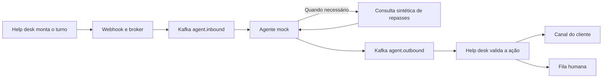

# 09 — Evolução da integração com a IA

Este documento descreve como integrar o agente no MVP e quais sinais justificam ampliar a integração. As propostas de evolução complementam o [escopo](02-escopo.md) e a [arquitetura](07-arquitetura.md).

## 1. Fluxo do MVP

O help desk envia o turno com contexto pelo Kafka. O agente consome o evento, consulta suas fontes quando necessário e devolve uma ação. O help desk decide se essa ação ainda pode ser aplicada e cuida da entrega ao cliente.

- **O help desk envia** a identificação do atendimento e da marca, os dados de cliente que o turno exige, as mensagens pendentes, o histórico previsto na RN-49 e os campos de correlação e prazo definidos no contrato.
- **O agente mantém internamente** a escolha de ferramentas, a montagem do prompt, o processamento do modelo e as buscas intermediárias. No MVP, o mock pode tomar a decisão por regras e consultar dados sintéticos.
- **O agente devolve** uma ação final (`reply`, `escalate` ou `resolve`), a identificação do turno, a versão do agente e a evidência relevante. O resumo de handoff explica o problema, as consultas realizadas e o que fica pendente para o analista. Os campos completos estão nos [contratos do 07](07-arquitetura.md#5-contratos).
- **O help desk valida** a atribuição, o prazo e a versão do contexto antes de aplicar a ação. Uma nova mensagem gravada invalida qualquer turno que ainda não a cobre. Esse controle vale mesmo se a consulta do agente já estiver em execução. [07 — Turnos](07-arquitetura.md#34-cliente-que-escreve-enquanto-a-ia-responde-turnos)

**Exemplo.** O cliente escreve “meu repasse não caiu” e completa aos 3 s com “é o de ontem, de R$ 1.200”. Se a ação do primeiro turno chegar após a gravação da segunda mensagem, ela é descartada. O próximo turno recebe as duas, consulta o repasse e pode responder “Seu repasse de R$ 1.200 está pendente”. Para o histórico, costuma bastar a evidência “consulta de status do repasse de ontem, resultado pendente, referência da consulta”. A proposta é limitar `tool_calls` aos campos úteis e autorizados da fonte. A execução completa pode ser observada do lado do agente, com o mesmo identificador de rastreio.

## 2. Quando o agente precisa buscar dados

### Histórico do help desk

O PostgreSQL da plataforma guarda conversas, tickets e resumos. O evento atende ao fluxo normal. Se casos concretos mostrarem que o agente frequentemente precisa de um trecho que ficou fora do contexto, a primeira extensão é uma **API interna de leitura**. Exemplo de caso de uso: recuperar uma mensagem com referência a um comprovante antigo do mesmo atendimento.

O serviço autentica o agente e valida marca, atendimento, atribuição e permissões no servidor. A consulta recebe paginação e limite de resposta. A API devolve `seq` e a referência da leitura para auditoria. Se o turno precisar ler histórico complementar, a busca fica limitada ao contexto autorizado para aquele turno. Uma mensagem mais recente entra no turno seguinte. O acesso ao PostgreSQL continua sob responsabilidade do help desk.

### Base de conhecimento e RAG

Na geração aumentada por recuperação (RAG), o agente busca trechos de artigos para embasar uma resposta. Para “qual o prazo normal de um repasse?”, a fonte é o artigo publicado para a marca e o idioma do cliente. A saída pode levar `article_id`, versão e trecho utilizado. A ferramenta aplica o escopo antes de devolver os resultados e trata o conteúdo recuperado como evidência, sem conceder novas permissões a partir de instruções contidas no texto.

- **Base mantida pela CloudWalk.** O agente consulta o serviço de busca já disponível, quando houver. O help desk recebe a referência de fonte prevista no contrato.
- **Base mantida pelo help desk.** Publicar artigos versionados e começar pela busca textual no PostgreSQL. Comparar com busca híbrida em uma amostra de perguntas em que sinônimos e paráfrases afetam o resultado. Se a busca vetorial melhorar a relevância com latência aceitável, `pgvector` pode complementar a busca textual. A geração de vetores dos artigos roda ao publicar ou reindexar, fora do caminho de resposta. O índice guarda a versão do artigo e do modelo de embeddings. [pgvector — Busca híbrida](https://github.com/pgvector/pgvector#hybrid-search)

### Dados transacionais

Para “o meu repasse de ontem caiu?”, o agente consulta a API que detém o estado do repasse. No MVP, a consulta usa dados sintéticos. O servidor autoriza a leitura para o cliente verificado e retorna campos estruturados. Se houver vários repasses compatíveis, o agente pede um detalhe. Se a consulta estiver indisponível, informa a limitação ou pede escalação conforme o cenário. Um artigo explica o prazo geral, enquanto a consulta transacional fundamenta a resposta sobre aquele repasse. [06 — Regras de negócio](06-regras-de-negocio.md)

### API HTTP e MCP

Uma função do agente pode chamar a API HTTP e transformar a resposta em dados estruturados para o modelo. Esse é o caminho inicial para uma integração conhecida entre dois sistemas. MCP passa a ter valor quando vários agentes ou copilotos precisam descobrir e chamar o mesmo catálogo de ferramentas. Nesse cenário, um adaptador MCP expõe a API já existente e reutiliza as regras de acesso, auditoria e limites. Ações sobre o atendimento continuam pelo contrato de saída do Kafka e passam pela validação do help desk. [MCP — Ferramentas](https://modelcontextprotocol.io/specification/2025-11-25/server/tools)

## 3. Como controlar latência e capacidade

- **Selecionar as ferramentas pelo caso.** Consulta de estado de repasse usa a API transacional. Dúvida sobre regra usa a base de conhecimento. Se a pergunta exigir ambas e as chamadas forem independentes, elas podem rodar em paralelo. Consultas dependentes usam o tempo restante do turno. Um resultado ausente precisa produzir um comportamento definido, como pedir um dado ou encaminhar o caso.
- **Aplicar orçamento a cada chamada.** Separar espera de agrupamento, fila, tempo de ferramenta, geração e entrega. Reservar tempo para publicar e aplicar a ação. Se o turno ficar elegível aos 4 s e a plataforma e a entrega consumirem 1 s no cenário, sobram cerca de 5 s de execução para caber em 10 s. É um exemplo de planejamento. A RNF-05 mede o p95 fim a fim com o mock a 2 s, e a RN-46 estabelece o fallback de 30 s a partir da primeira mensagem pendente. [05 — Latência e experimentos](05-requisitos-nao-funcionais.md#4-experimentos-que-comprovam-os-rnf)
- **Limitar o trabalho desperdiçado.** O agente verifica o prazo antes de iniciar uma consulta e nas retentativas. Se receber um sinal de invalidação, pode cancelar trabalho em andamento quando a fonte permitir. O help desk rejeita ações antigas de qualquer forma. Reutilizar resultados só quando identidade, marca, parâmetros e validade temporal ainda coincidirem. O estado atual de um repasse pode mudar entre duas consultas.
- **Medir filas antes de ampliar a arquitetura.** Com 48 partições e uma execução simultânea por partição, um tempo médio de 2 s por turno dá um teto teórico de 24 turnos/s. A média de 6 s reduz esse teto para 8 turnos/s. A vazão observada também depende do paralelismo configurado, da distribuição das conversas e dos limites das fontes. Se o E5 mostrar que uma consulta lenta bloqueia outras conversas na mesma partição, avaliar uma fila de execução durável no agente. Confirmar o offset após persistir o trabalho, deduplicar por `event_id` e limitar concorrência por fonte. [07 — Escalabilidade](07-arquitetura.md#7-escalabilidade)

**Experimento sugerido.** Ampliar os cenários do mock com uma consulta rápida, uma consulta que estoura o orçamento e uma correção do cliente durante a execução. Registrar tempos por etapa, latência fim a fim, erros por fonte, turnos superados e escalações. Comparar conversas independentes e rajadas na mesma conversa. A ausência de resposta por descarte, timeout ou escalação também deve aparecer no resultado do teste.

## 4. Como avaliar uma nova versão do agente

**Replay offline.** Montar casos sintéticos com o contexto do turno, as respostas esperadas das ferramentas e o resultado esperado. Registrar a versão do agente, a configuração, a versão dos artigos e o identificador da execução. Reexecutar com um relógio de teste e respostas de ferramentas fixadas, fora do canal do cliente. “Resolvido”, “reaberto” e “escalado” ajudam a selecionar casos. Para medir acerto, o gabarito precisa dizer qual resposta ou ação era adequada naquele cenário.

- **Checagens determinísticas.** Conferir cliente e marca consultados, repasse esperado, valor e status, presença de todas as mensagens pendentes, rejeição do turno superado, ação de handoff e versão do artigo retornado. Se houver busca de conhecimento, medir quantas perguntas trazem pelo menos um artigo relevante entre os primeiros resultados e o tempo da busca.
- **LLM como juiz.** Aplicar em lote quando houver texto gerado para avaliar. Usar o histórico e os resultados das ferramentas como evidência. Uma rubrica pode perguntar se o resumo é fiel ao histórico e se a resposta explica o próximo passo. Calibrar comparando com uma amostra revisada por pessoas. Ao comparar duas versões, alternar sua ordem e registrar modelo, prompt e rubrica do juiz. [Zheng et al. — *Judging LLM-as-a-Judge*](https://arxiv.org/abs/2306.05685)
- **Modo sombra.** Quando houver duas versões e o replay já cobrir os casos principais, uma versão candidata pode receber uma cópia dos turnos em um grupo de consumidores separado. Publicar os resultados em um destino de avaliação, sem acesso aos tópicos de ação ativa. Usar ferramentas simuladas ou permissões próprias de leitura com limite de taxa. O teste deve comprovar que nenhuma saída chega ao cliente e que a carga do candidato cabe no orçamento das fontes. [Apache Kafka — Introdução](https://kafka.apache.org/intro/)

## 5. Ordem proposta de evolução

1. **Demonstrar o cenário de repasse com o mock.** Enviar duas mensagens no mesmo atendimento, consultar uma fonte sintética e aplicar uma única ação válida. Repetir com consulta lenta e com correção do cliente durante a execução.
2. **Adicionar replay com gabarito.** Guardar os casos que revelaram falhas de contexto, permissões, prazo e handoff. Usar esses casos para comparar alterações no agente ou na integração.
3. **Adicionar somente as leituras justificadas por casos observados.** Usar uma API interna para lacunas do histórico e uma busca de conhecimento se o agente precisar de artigos. Investir em busca vetorial se o teste de recuperação indicar ganho.
4. **Avaliar a qualidade do texto e novas versões.** Introduzir o juiz quando houver geração de texto e usar modo sombra quando houver uma versão candidata que justifique comparação sob carga. Avaliar MCP quando existir demanda de interoperabilidade além do agente atual.

No onboarding, confirmar quem mantém a base de conhecimento, quais ferramentas o agente real já usa, que evidências consegue devolver e se consegue respeitar prazos ou interromper uma consulta. Essas respostas determinam quais extensões precisam entrar no desenho de integração real.
